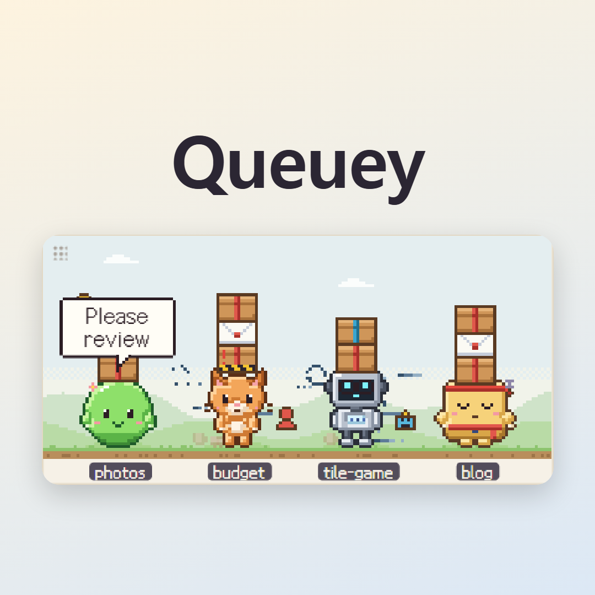
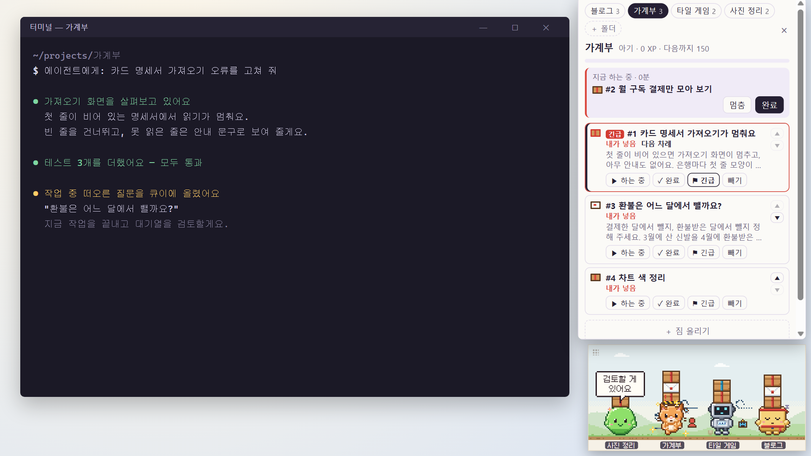
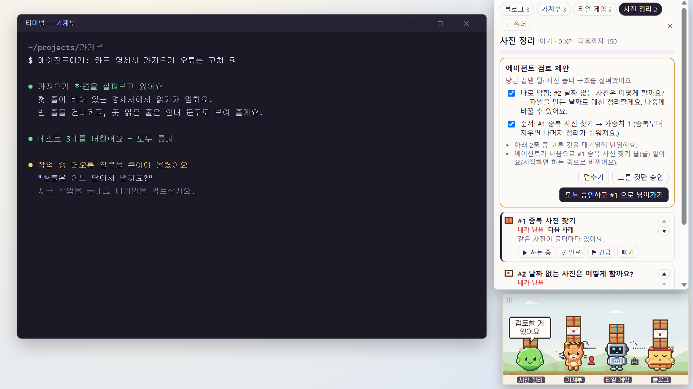
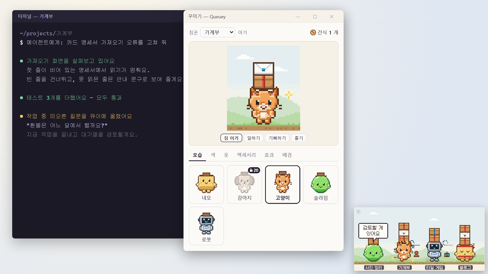

## 한국어

화면 오른쪽 아래의 작은 짐꾼이 할 일을 머리에 이고 줄 서 있습니다. 지금 하는 일을 끊지 않고 떠오른 질문·할 일을 맡겨 두고, 손이 비면 하나씩 꺼내 처리하세요. AI 코딩 에이전트(예: Claude Code)와 연결하면 에이전트도 같은 줄에 질문을 세우고, 다음 할 일을 제안합니다.

- Windows 데스크톱 · 오프라인 · 계정 없음 · 무료 · 한국어/영어
- 소개 글: [에이전트에게 끼어드는 대신, 줄을 세웠습니다]()

<a href="https://apps.microsoft.com/detail/9PNV73XF9B4N?hl=ko-kr&gl=KR"><strong>▶ Microsoft Store 에서 큐이 설치하기</strong></a>

### 문서
- [개인정보 처리방침](/apps/queuey/privacy/)
- [최종 사용자 라이선스 계약(EULA)](/apps/queuey/eula/)
- [오픈소스 고지](/apps/queuey/notices/)

### 지원
문의·오류 제보: `raltlsdn@naver.com`

---

## English

A small porter in the bottom-right corner of your screen carries your to-dos on its head, standing in line. Hand off the questions and tasks that pop up without breaking your flow, then take them one at a time when your hands are free. Connect an AI coding agent (such as Claude Code) and it can line up its own questions and propose what to do next.

- Windows desktop · offline · no account · free · English/Korean

<a href="https://apps.microsoft.com/detail/9PNV73XF9B4N?hl=en-us&gl=US"><strong>▶ Get Queuey from the Microsoft Store</strong></a>

### Documents
- [Privacy Policy](/apps/queuey/privacy/)
- [End User License Agreement (EULA)](/apps/queuey/eula/)
- [Third-party notices](/apps/queuey/notices/)

### Support
Questions and bug reports: `raltlsdn@naver.com`
