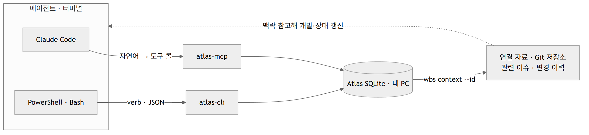
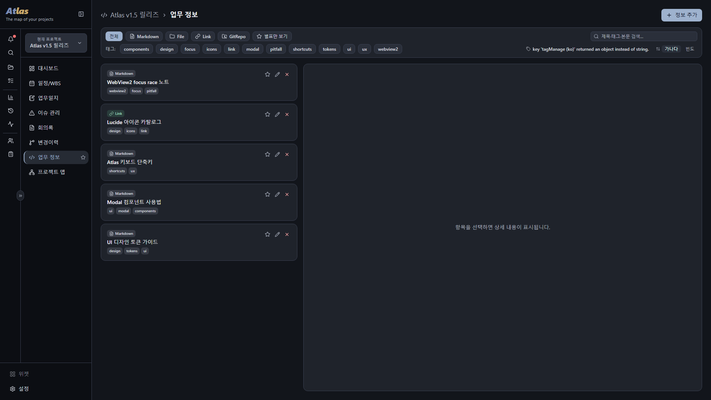

> AI 에이전트가 직접 다루는 프로젝트 관리 도구를 만든 이유.

🗺️ **Atlas 이야기** · [① 소개]() · [② 만든 이야기]() · **③ 에이전틱 자동화** · [④ 스토어 이야기]()

---

대부분의 프로젝트 관리 도구는 **사람이 마우스로 클릭**합니다. 작업을 만들고, 상태를 바꾸고, 관련 자료를 찾아 여는 일까지 전부 손으로. 저는 Atlas 를 만들면서 여기에 길을 하나 더 냈습니다. **AI 에이전트가 데이터를 직접 조회하고 갱신하고, 실제 개발까지 이어 가도록** — 외부 자동화를 곁다리 기능이 아니라 1급 기능으로 설계한 것입니다.

이유는 단순합니다. [지난 글]()에서 말했듯 저는 이 앱을 혼자 만들면서 AI 와 짝을 이뤄 일했고, 그러다 보니 "AI 가 내 프로젝트 데이터를 사람처럼 클릭할 수는 없으니, 아예 프로그램으로 다루게 하자"는 결론에 자연스럽게 닿았기 때문입니다.

## 세 개의 진입로

Atlas 로 들어오는 자동화 입구는 셋입니다.

- **`atlas-cli` (셸)** — PowerShell·Bash 에서 verb 로 호출하고 결과를 JSON 으로 뱉습니다. 스크립트, CI/CD, 대량 일괄 처리에 강합니다.
- **`atlas-mcp` (MCP 서버)** — Claude Code 가 stdio Model Context Protocol 로 직접 호출합니다. 자연어 한 줄이면 알맞은 도구가 자동으로 골라져 데이터에 반영됩니다.
- **Claude Code 스킬** — `atlas-cli skill install` 한 번이면 사용 가이드가 `~/.claude/skills/atlas` 에 설치되어, **어느 프로젝트에서 Claude Code 를 켜든** "atlas-cli 로 …" 한마디에 자동으로 적용됩니다.



셋 다 GUI 와 **같은 데이터 폴더**를 자동으로 찾아 붙고, SQLite WAL 모드라 Atlas 앱이 켜져 있는 상태에서도 동시에 안전하게 씁니다.

## 핵심은 "맥락을 한 번에 모으는" 한 콜

에이전트에게 작업을 시킬 때 가장 큰 마찰은 맥락 수집입니다. "이 작업을 개발해 줘"라고 하려면, 먼저 그 작업이 뭔지, 어떤 자료에 기대는지, 관련 이슈와 저장소는 어디인지를 다 찾아 줘야 하죠. Atlas 에는 이걸 한 방에 끝내는 명령이 있습니다.

```bash
atlas wbs context --id 42
```

이 한 줄이면 42번 작업에 걸린 **연결 자료 · Git 저장소 경로 · 관련 이슈 · 변경 이력**이 한 덩어리로 딸려 옵니다. 흩어진 정보를 헤맬 필요 없이, 에이전트는 이 번들을 읽고 곧바로 "관련 정보를 참고해 개발하고, 끝나면 상태를 갱신"하는 흐름에 들어갑니다.



## 덤프하지 말고, 좁혀서 받는다

에이전트와 일할 때 토큰은 곧 비용이자 정확도입니다. 그래서 Atlas 의 모든 조회는 **DB 단에서 걸러서** 돌려줍니다.

- **필터** — 상태·기간·담당자·키워드 등으로 서버(DB)에서 미리 좁힙니다.
- **출력 셰이핑** — `--count`(개수만) · `--brief`(축약) · `--fields`(원하는 필드만)로 응답을 다이어트합니다.
- **전문 검색(FTS5)** — 엔티티를 가로질러 한 번에 검색합니다.

전체를 덤프한 뒤 훑는 방식과는 체감이 다릅니다. 필요한 조각만 정확히 받아 오니 대화가 가벼워집니다. 이렇게 노출되는 도구는 현재 **79종**입니다.

## 누가 바꿨는지 흐려지지 않게

AI 가 데이터를 만질 수 있게 열어 두면, 자연히 걱정되는 게 "사람이 한 것과 AI 가 한 것이 뒤섞이는" 문제입니다. Atlas 는 활동 기록에 진입로별 **actor**(`claude-code` / `claude-code-mcp`)를 함께 남깁니다. 나중에 활동 페이지에서 사람 편집과 AI 편집을 갈라서 되짚을 수 있습니다.

## 설치하면 이미 들어 있다

이 자동화 도구들은 별도로 받는 게 아닙니다. **Microsoft Store 설치본 안에 CLI·MCP 가 함께 들어 있고**, App Execution Alias 로 터미널 어디서나 `atlas-cli`·`atlas-mcp` 로 바로 부를 수 있습니다. GUI 와 같은 패키지로 실행되니 데이터도 항상 일치합니다.

시작은 이렇게 간단합니다.

```powershell
# 1) Microsoft Store 에서 Atlas 설치 후,
# 2) Claude Code 와 함께 쓰려면 한 번만 등록
claude mcp add --scope user atlas atlas-mcp

# 3) (선택) 어느 프로젝트에서든 "atlas-cli 로 …"가 통하게 스킬 설치
atlas-cli skill install
```

이제 Claude Code 에 **"atlas-cli 로 이 작업 관련 정보 참고해서 개발해"** 한마디면, 맥락 수집부터 상태 갱신까지 한 흐름으로 이어집니다. 제가 Atlas 를 만들 때 실제로 쓴 방식이기도 합니다.

<p align="center">
  <a href="https://apps.microsoft.com/detail/9NMW5KS7HD1R?hl=ko-kr&gl=KR"><strong>▶ Microsoft Store 에서 Atlas 설치하기</strong></a>
</p>

---

🗺️ **다음 편** — [④ 스토어 이야기: 파란 경고창을 지우기까지 — Atlas 를 Microsoft Store 에 올린 이야기]()
