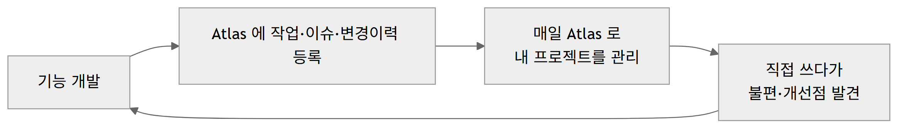
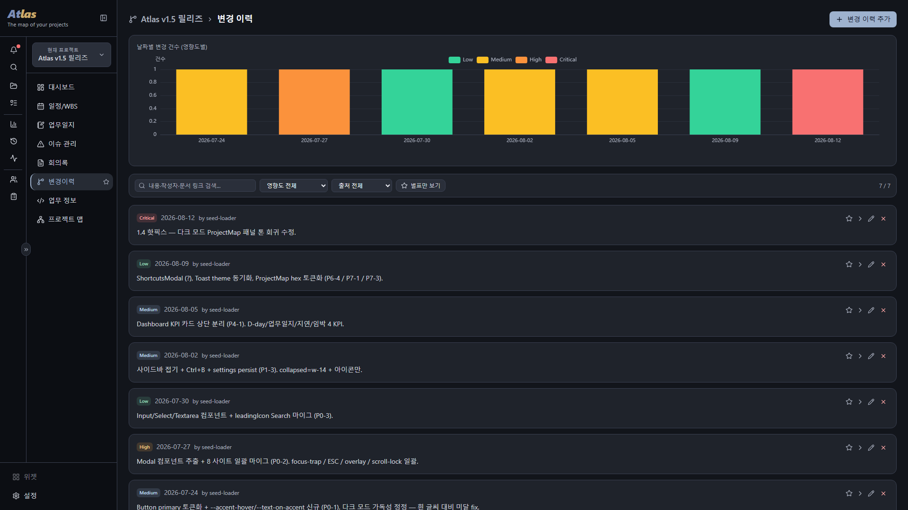
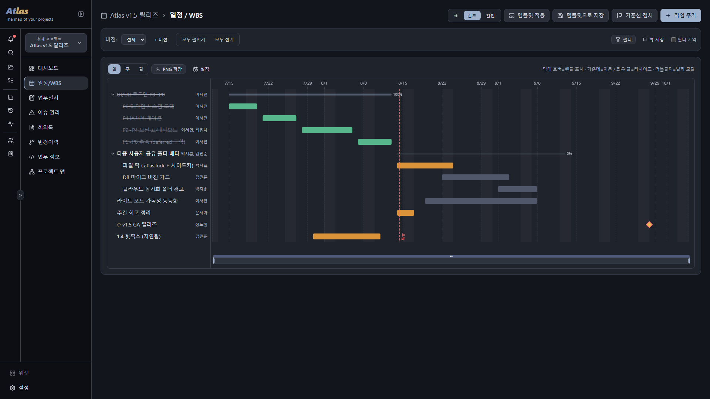

> 제 첫 애플리케이션 Atlas 를 만든 이야기.

🗺️ **Atlas 이야기** · [① 소개]() · **② 만든 이야기** · [③ 에이전틱 자동화]() · [④ 스토어 이야기]()

---

Atlas 는 제가 처음으로 끝까지 만들어 세상에 내놓은 애플리케이션입니다. 그래서 이 글은 기능 소개라기보다, **만드는 과정 자체에 대한 이야기**에 가깝습니다.

## 왜 하필 프로젝트 관리 앱이었나

솔직히 말하면, 가장 절실하게 필요했던 게 그거였기 때문입니다. 혼자 이것저것 벌여 놓으면 관리할 대상이 코드만이 아니더군요. 일정이 있고, 이슈가 있고, 회의에서 나온 결정이 있고, 참고할 자료와 저장소가 있습니다. 이걸 노션에도 적어 보고, 스프레드시트에도 적어 보고, 메모 앱에도 흩뿌려 봤지만 — 결국 "내 데이터가 여기저기 흩어져 있고, 어딘가의 서버에 얹혀 있다"는 감각이 계속 걸렸습니다.

그래서 원하는 걸 직접 정의했습니다. **계정 없이, 내 PC 안에서, 여러 프로젝트를 한 화면에서.** 이 세 가지가 Atlas 의 출발점이었고, 지금까지도 흔들지 않은 축입니다.

## 만드는 도구로, 만드는 과정을 관리하다

여기서부터가 재미있는 부분입니다. 저는 Atlas 를 만들면서, **그 개발 과정 자체를 Atlas 안에 기록했습니다.** 기능 하나를 붙일 때마다 그 작업을 Atlas 의 첫 번째 프로젝트에 WBS 작업으로 올리고, 버그는 이슈로, 바꾼 내용은 변경 이력으로, 릴리즈는 마일스톤으로 남겼습니다. 커밋 하나가 개발로그 한 편이 되도록 규율도 정했습니다. 말하자면 Atlas 로 Atlas 를 관리한 셈입니다.

이 작은 순환에는 뜻밖의 장점이 있었습니다. **불편을 사용자보다 개발자인 제가 먼저 겪는다**는 것. 매일 Atlas 안에서 회의록을 읽고 이슈 메모를 들여다보다 보면, 결이 자꾸 눈에 걸립니다. "여기 마크다운 표가 왜 안 그려지지?", "코드 블록이 밋밋한데?", "마감이 코앞인데 왜 아무도 안 알려주지?" 이런 불편들이 그대로 다음 할 일이 됐습니다.

- 앱 곳곳의 **마크다운을 전면적으로 손본 것**(표·체크리스트·코드 구문 강조까지)은, 제가 매일 그 화면을 읽다가 답답해서 시작한 일입니다.
- 마감 임박과 하루 정리를 알려 주는 **알림 기능**도, "내가 자꾸 놓치니까" 붙인 것입니다.

기획서에서 나온 기능이 아니라, 쓰다가 아쉬워서 나온 기능들. 도그푸딩이 아니었으면 우선순위 뒤편에 묻혔을 것들입니다.

## 개발 흐름도 Atlas 위에서

개발할 때의 흐름도 Atlas 에 기대게 됐습니다. 작업 하나를 손보기 전에, 저는 그 작업에 연결해 둔 자료·저장소·이슈·변경 이력을 한 번에 불러옵니다. 흩어진 맥락을 찾아 헤맬 필요 없이, 필요한 배경이 한 덩어리로 딸려 오니 곧바로 손을 댈 수 있습니다. (이 부분 — AI 에이전트가 이 맥락 번들을 직접 읽고 개발까지 잇는 이야기 — 은 워낙 할 말이 많아서 [세 번째 글]()로 따로 뺐습니다.)

## 혼자, 그러나 혼자가 아니게

첫 앱을 혼자 만든다는 건 생각보다 외로운 일입니다. 설계도 나 혼자, 결정도 나 혼자, 막히는 것도 나 혼자. 그래서 저는 개발 과정에 AI(Claude Code)를 적극적으로 끌어들였고, 그 협업을 위해 아예 Atlas 에 **AI 가 데이터를 직접 읽고 갱신할 수 있는 통로**를 1급 기능으로 넣었습니다. 사람이 만든 편집과 AI 가 만든 편집이 활동 기록에서 구분되도록까지요. 만드는 방식이 곧 만들어지는 제품의 일부가 된, 조금 특이한 경험이었습니다.

## 그리고 로컬 우선이라는 리듬

돌아보면 "로컬 우선"이라는 선택이 1인 개발의 리듬과 유난히 잘 맞았습니다. 켜면 바로 내 데이터, 닫으면 내 디스크에 그대로. 서버를 띄우고 배포하고 관리하는 부담 없이, 만드는 일에만 집중할 수 있었습니다. 첫 앱을 끝까지 완성할 수 있었던 데에는 이 단순함의 몫이 큽니다.

Atlas 는 지금도 Atlas 안에서 관리되며 자라고 있습니다. 이 글을 쓰는 지금 이 순간의 작업도, 물론 Atlas 에 하나 올라가 있습니다.

  <a href="https://apps.microsoft.com/detail/9NMW5KS7HD1R?hl=ko-kr&gl=KR"><strong>▶ Microsoft Store 에서 Atlas 설치하기</strong></a>

---

🗺️ **다음 편** — [③ 에이전틱 자동화: 클릭하지 않는 프로젝트 관리 — Atlas 의 CLI · MCP · Claude Code 스킬]()
