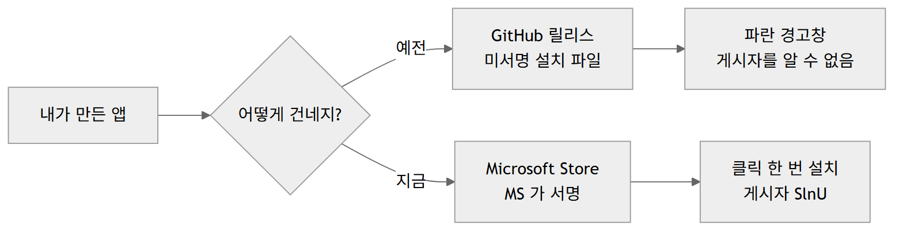

> 제가 만든 앱을 세상에 내놓는 방법을 다시 정한 이야기 — GitHub 릴리스에서 Microsoft Store 로.

🗺️ **Atlas 이야기** · [① 소개]() · [② 만든 이야기]() · [③ 에이전틱 자동화]() · **④ 스토어 이야기**

---

몇 달을 매달려 만든 앱을 처음으로 누군가에게 건넸을 때, 제가 마주한 건 고맙다는 말이 아니라 **파란 전체 화면**이었습니다. "Windows 의 PC 보호 — 게시자를 알 수 없는 앱입니다." 굵은 경고 아래, 작게 접혀 있는 "실행" 버튼. 제 몇 달치 작업이 화면 위에서는 조심해야 할 무언가처럼 보였습니다. 더 뼈아팠던 건 — 이게 안전하다는 걸, 만든 저조차 증명할 방법이 없었다는 것입니다.

이건 Atlas 라는 앱을 처음 어떻게 세상에 내놓았고, 저 파란 경고창이 왜 그렇게 마음에 걸렸으며, 결국 그 경고가 뜨지 않는 선반 위로 앱을 통째로 옮긴 이야기입니다. (Atlas 가 어떤 앱인지는 [따로 소개한 글]()이 있으니 여기선 접어 두고, 오늘은 "어떻게 건넸나"만 이야기하겠습니다.)

## 처음엔, 압축 파일 하나로 — GitHub 릴리스

첫 배포는 가장 손쉬운 길을 골랐습니다. 빌드해서 나온 `Atlas.exe` 와 화면 파일을 zip 하나로 묶어 **GitHub 릴리스**에 올리고, 사람들이 받아서 압축을 풀고 실행하는 방식. 서버도, 설치 절차도 없이 파일 하나만 건네면 되니 1인 개발자에게는 딱 맞아 보였습니다.

여기에 곧 살을 붙였습니다. Inno Setup 으로 **설치 파일**(`Atlas-Setup-*.exe`)을 만들어 더블클릭 한 번으로 깔리게 하고, 앱이 스스로 새 버전을 확인하도록 **인앱 업데이터**도 넣었습니다. 앱이 GitHub 의 최신 릴리스 태그를 제 버전과 비교해서, 새 게 있으면 알려 주고 받아 오는 식입니다. 관리자 권한도 필요 없는 사용자 폴더 설치라, 부담 없이 깔 수 있었죠.

돌아보면 그건 **봉투에 담아 직접 건네는** 방식이었습니다. 릴리스 페이지에 zip 과 설치 파일을 손수 올려 두고, "여기서 받으세요" 하고 내미는. 작동은 잘 했습니다. 딱 하나, 받는 사람 쪽 화면만 빼면요.

## 파란 경고창 앞에서 — "게시자를 알 수 없음"

문제의 정체는 단순했습니다. 제 설치 파일에는 **코드 서명**이 없었습니다. 서명 없는 실행 파일을 Windows 의 SmartScreen 이 만나면, "알 수 없는 게시자" 라며 파란 벽을 세웁니다. 악성이라서가 아니라, **누가 만들었는지 증명된 도장이 없어서**입니다.

여기엔 사연이 있습니다. 코드 서명 인증서는 돈이 드는 데다, 설령 사서 도장을 찍어도 **한동안은 경고가 그대로**입니다. Windows 가 "이 게시자, 믿어도 되나"를 판단할 평판이 쌓이기 전까지는요. 그러니 개인 개발자에게 그 벽은, 돈을 낸다고 바로 사라지지도 않는 벽이었습니다.

정말 뼈아팠던 건 기술적인 부분이 아니라 그 감각이었습니다. **제가 만든 앱인데, 제가 만들었다는 걸 보여 줄 도장이 없다.** 받는 사람 입장에선, 낯선 사람이 문 앞에 두고 간 정체불명의 봉투처럼 보이는 겁니다. 앱을 열기도 전에 "이거 괜찮은 거 맞아?" 부터 물어야 하는. 그 첫인상이 계속 마음에 걸렸습니다.

## 증명을 Microsoft 에 맡기다

길을 찾다가 도착한 곳이 **Microsoft Store** 였습니다. 핵심은 이 한 줄입니다 — 스토어에 올린 앱은 **Microsoft 가 서명**합니다. 제가 서명하지 않은 패키지를 올리면, 검수를 거쳐 Microsoft 의 인증서로 서명해서 배포해 줍니다. 그러니 사용자 화면엔 파란 경고창 대신, **앱 이름과 게시자 이름**(SlnU)이 뜹니다.

말하자면 "이 게시자, 믿어도 되나"라는 질문의 답을 이제 **Microsoft 가 대신 보증**해 주는 셈입니다. 낯선 봉투가 아니라, 매장 선반 위에 정품으로 놓인 물건. 제가 몇 달을 매달려 만든 것이, 드디어 그렇게 보일 수 있게 됐습니다.

## 설치도, 업데이트도, 그냥 되게 — 게다가 대부분 Windows 앱이라

경고창만 사라진 게 아니었습니다. 스토어로 옮기니 그동안 제가 손으로 챙기던 것들을 Store 가 대신 해 줬습니다.

- **설치** — 스토어 페이지에서 클릭 한 번. 압축을 풀 필요도, 관리자 권한도 없습니다.
- **업데이트** — Store 가 알아서 최신으로 유지합니다. 그래서 스토어 빌드에서는 앱 안의 자체 업데이터를 아예 꺼 뒀습니다. 두 개가 서로 밀치지 않게.
- **런타임** — 화면을 그리는 WebView2 같은 의존성도 Store 가 함께 챙깁니다. "실행하려면 뭘 더 깔라"는 안내가 필요 없습니다.

그리고 제겐 결정적인 이유가 하나 더 있었습니다. **제가 만드는 건 대부분 Windows 데스크톱 앱**입니다. 그렇다면 Windows 가 가장 잘 아는 통로, 사람들이 이미 앱을 찾으러 들르는 그 선반에 올려 두는 게 자연스러웠습니다. 애써 배포 페이지를 알리지 않아도 **스토어 안에서 발견되는** 것은 덤이고요.

## 옮기는 데엔 잔손이 많이 갔습니다

솔직히 말하면, 스토어로 다시 포장하는 일은 생각보다 잔손이 많았습니다. 포터블 zip 을 만들던 파이프라인과 달리 **MSIX** 라는 스토어용 패키지로 다시 싸야 했고, 그 과정에서 챙길 게 줄줄이 딸려 나왔습니다.

- **라이선스 정비** — 소스 라이선스를 정리하고, 스토어 바이너리에는 별도의 사용권(EULA)을 붙였습니다.
- **업데이터 분기** — 앱이 "나 지금 스토어 패키지로 돌고 있네"를 스스로 감지해, 그럴 때만 자체 업데이트 기능을 접도록 했습니다.
- **웃픈 함정 하나** — 첫 제출이 대뜸 **"헤드리스 앱"이라며 거부**됐습니다. 알고 보니 함께 넣은 명령줄 도구(`atlas-cli`·`atlas-mcp`)를 시작 메뉴에서 숨기려고 준 설정을, 스토어가 "이건 화면 없는 앱이잖아?"로 오해한 거였죠. 숨김을 포기했더니 통과됐습니다.

이런 잔손들. 그래도 한 번 길을 닦아 두니, 그다음부터는 `publish.ps1 -Msix` 한 줄이면 제출본이 나옵니다. 처음의 번거로움은, 매번 파란 경고창을 설명하지 않아도 되는 값으로 되돌아왔습니다.

## 한 선반에 나란히 — Atlas 만이 아니라서

사실 이 고민은 Atlas 하나로 끝나지 않았습니다. 제가 만드는 게 대부분 Windows 데스크톱 앱이다 보니, **"저 파란 경고창을 어떻게 지우지"** 는 새 앱을 낼 때마다 돌아오는 질문이었습니다. 그래서 만드는 것들을 아예 **같은 선반에 나란히** 올리기로 했습니다.

- **ShotLog** — 화면을 찍고, 바로 그 자리에 메모를 남겨, 받은 편지함에 모아 두는 도구. 캡처와 기록 사이의 틈을 없앴습니다.
- **PulsarDock** — 즐겨찾기와 타이머를 커서 주변·화면 가장자리·작은 위젯으로 불러내는 런처. 자주 여는 것들을 손 닿는 곳에 둡니다.
- **README.md** — 이름 그대로, 가볍게 읽고 쓰는 마크다운 리더 겸 에디터.
- **Clowder** — 여러 Claude Code 세션을 한 창에 나란히 띄우는 터미널 작업 공간.
- **TODO.md** — 여러 프로젝트를 오가는 동안 화면 가장자리에 붙어 있는 할 일 띠.
- **큐이(Queuey)** — 작업 중 떠오른 질문·할 일을 머리에 이고 줄 서 있는 픽셀 짐꾼. ([소개 글]())

모두 Atlas 와 같은 원칙 — **로컬 우선, 내 PC 안에서** — 으로 만들었고, 모두 같은 Microsoft Store 선반 위에 있습니다. 전체 목록은 [앱 페이지](/apps/)에 모아 두었습니다. 누구에게 건네도 파란 경고창부터 마주하지 않는, 그런 선반 위에요.

이제 제가 만든 걸 누군가에게 건넬 때, 첫 화면은 조심하라는 경고가 아닙니다. 앱 이름과, 그 아래 제 이름. 별것 아닌 것 같아도 — 만든 사람에겐 그 한 줄이, 파란 경고창과 정확히 반대편의 무게로 다가옵니다.

  <a href="https://apps.microsoft.com/detail/9NMW5KS7HD1R?hl=ko-kr&gl=KR"><strong>▶ Microsoft Store 에서 Atlas 설치하기</strong></a>

---

🗺️ **처음으로** — [① 소개: Atlas — 당신의 모든 프로젝트, 한 장의 지도]()
