> 제가 직접 만든 첫 번째 애플리케이션, **Atlas** 를 소개합니다.

🗺️ **Atlas 이야기** · **① 소개** · [② 만든 이야기]() · [③ 에이전틱 자동화]() · [④ 스토어 이야기]()

---

혼자 여러 가지를 벌여 놓다 보면, 어느 순간 머릿속이 열어 둔 브라우저 탭처럼 되어 버립니다. 이건 어디까지 했더라, 저 이슈는 어떻게 처리했더라, 그때 회의에서 뭘 결정했더라… 흩어진 조각들을 붙잡느라 정작 일에 쓸 집중력이 새어 나가더군요. 제가 필요했던 건 이 모든 걸 한자리에 펼쳐 놓고 볼 수 있는 **지도 한 장**이었습니다. 마땅한 게 없어서 직접 만들었고, 그게 Atlas 입니다.

Atlas 는 한 사람이 여러 프로젝트의 일정·이슈·회의·변경 이력·자료를 한 곳에서 관리하는 Windows 데스크톱 앱입니다. 이름 그대로, 흩어진 프로젝트들을 한 장의 지도처럼 펼쳐 놓고 봅니다.

## 계정도, 서버도 없이 — 로컬 우선

만들면서 처음부터 끝까지 지킨 원칙이 하나 있습니다. **모든 데이터는 내 PC 에.** 계정 가입도, 로그인도, 원격 서버도 없습니다. 데이터는 내 컴퓨터의 SQLite 데이터베이스 하나와 프로젝트별 파일 폴더에 그대로 담깁니다.

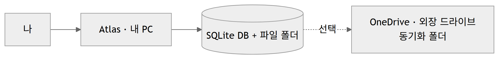

데이터 폴더의 위치는 자유롭게 바꿀 수 있습니다. OneDrive 같은 동기화 폴더나 외장 드라이브를 가리키면 자동 백업과 여러 기기에서의 사용까지 자연스럽게 따라옵니다. 클라우드에 내 일감을 굳이 올리고 싶지 않은 사람에게 잘 맞습니다. 어딘가 서버에 문제가 생겨서 내 기록을 못 보는 일은, 적어도 Atlas 에서는 없습니다.

## 화면으로 보는 Atlas

말보다 화면이 빠릅니다. 프로젝트 하나의 안쪽부터 전체 포트폴리오까지, 주요 화면을 함께 훑어보겠습니다.

### 프로젝트 허브 · 대시보드

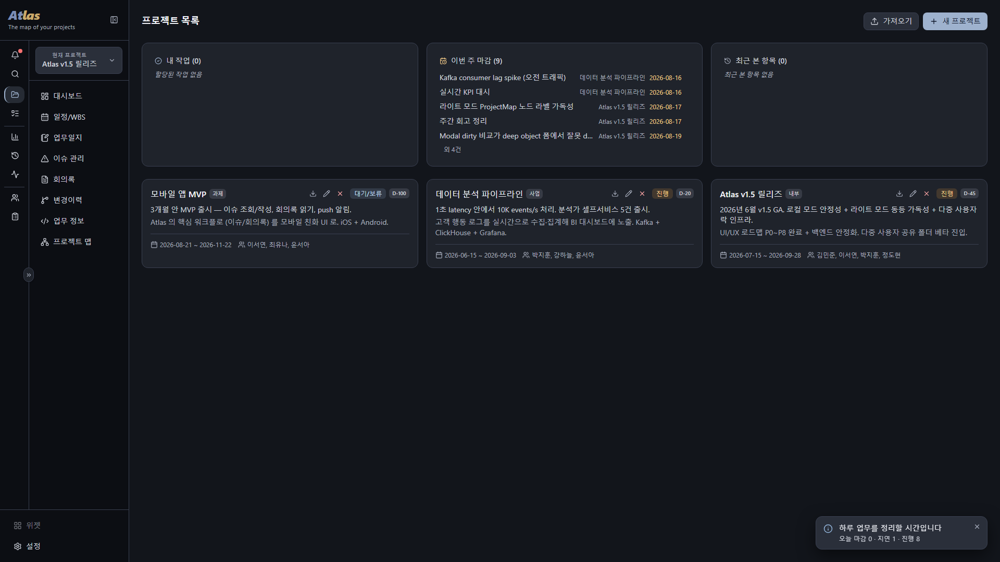

시작은 프로젝트 카드 목록입니다. 진행 중인 것들을 한눈에 늘어놓고, 그중 하나를 열면 대시보드가 맞이합니다.

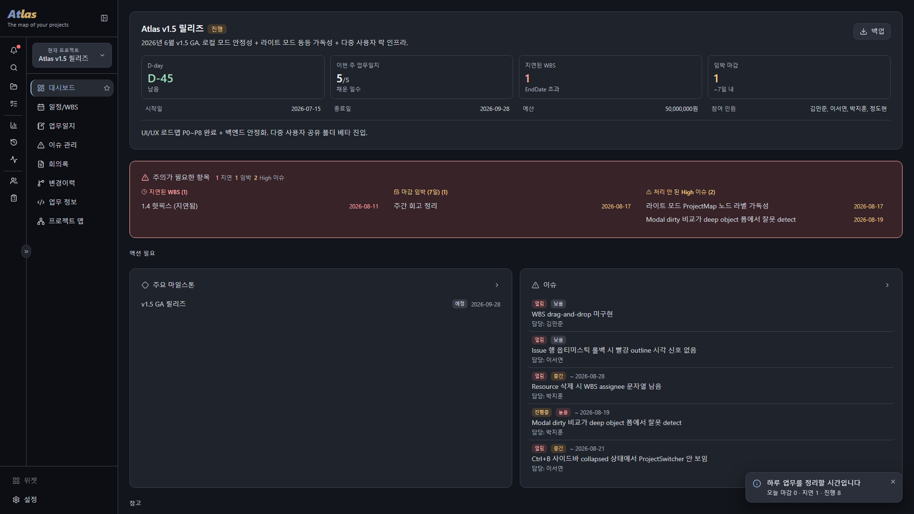

개요·예산·인원·D-day, 그리고 최근 활동·다가오는 마일스톤·최근 이슈와 회의록이 위젯으로 모여 있어서, 프로젝트에 다시 앉을 때 "지금 여기가 어디였지"를 몇 초 만에 되찾습니다.

### 일정 — WBS · 간트 · 칸반

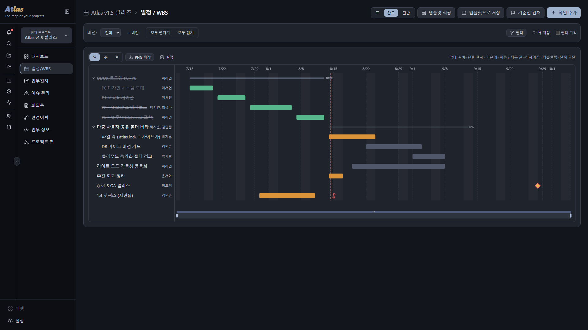

일정은 계층 작업 트리(WBS)로 잡습니다. 마일스톤, 상태(예정·대기·진행·완료), 중요도, 여러 담당자, 그리고 작업마다 붙는 마크다운 메모까지. 같은 데이터를 **간트 차트**로도, 상태·담당자로 묶는 **칸반 보드**로도 볼 수 있고, 칸반에서는 카드를 끌어다 상태를 바꿉니다. 작업 하나에서 관련 이슈와 자료를 바로 연결해 두면, 나중에 그 작업을 다시 열었을 때 맥락이 통째로 딸려 옵니다.

### 내 업무 — 흩어진 할 일을 한 화면에

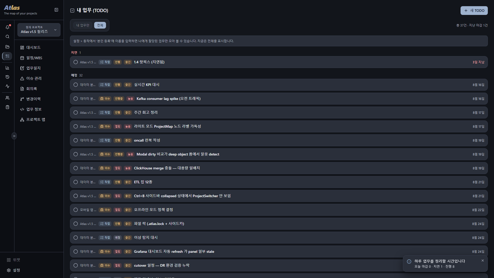

프로젝트가 여러 개면 "오늘 내가 뭘 해야 하지"가 프로젝트마다 흩어집니다. 그래서 전 프로젝트의 미완 작업·미해결 이슈에 개인 할 일(반복 지원)까지 **한 화면**에 모아 두고, 한 줄로 완료 처리합니다.

### 이슈 · 변경 이력

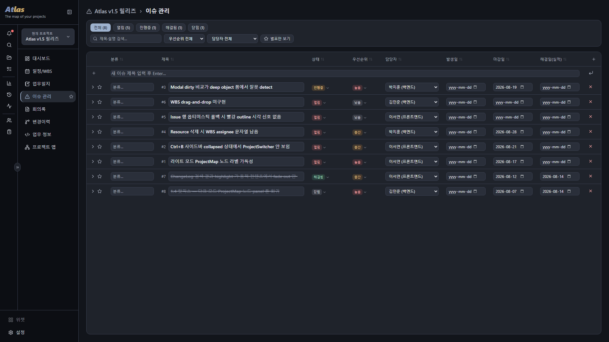

이슈는 상태(열림·진행·해결·닫힘)와 우선순위로 관리하고, 표 위에서 배지를 눌러 그 자리에서 상태를 바꿉니다. 분류와 사용자 정의 컬럼도 붙일 수 있습니다.

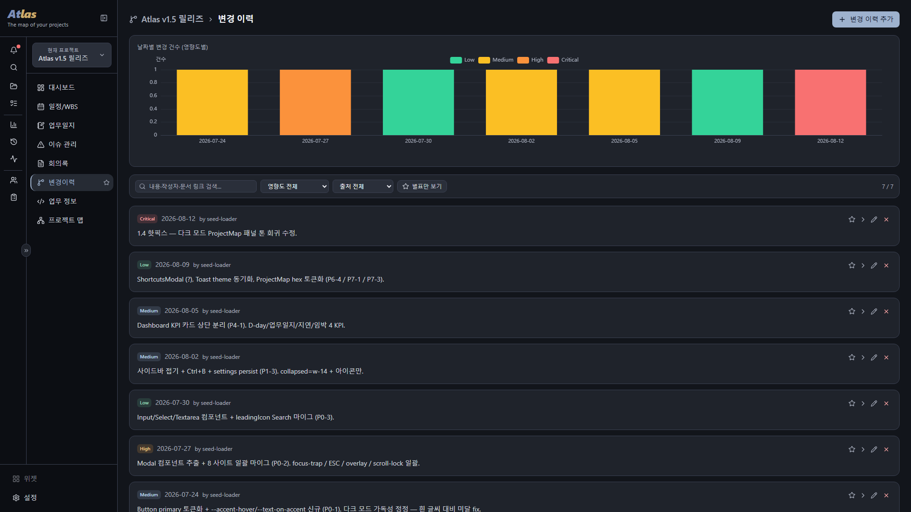

무엇을 바꿨는지는 **변경 이력**에 영향도와 함께 남고, 일자별 차트로 쌓입니다. 각 변경은 출처가 된 이슈·작업, 관련 문서·회의로 되짚어 갈 수 있습니다.

### 회의록 — 기록이 그대로 문서가 되도록

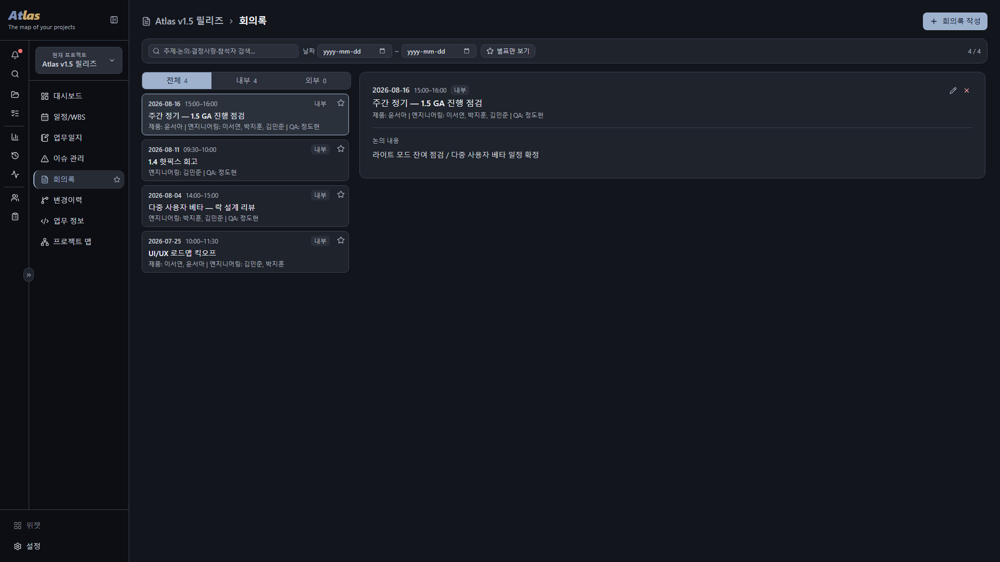

회의록은 참석자·논의·결정·액션 아이템(담당자·마감)을 남기는데, 여기서 제가 특히 아끼는 부분이 있습니다. 회의록은 데이터 폴더의 `Meetings/` 안에 **사람이 읽기 좋은 마크다운으로 자동 저장**됩니다. Obsidian 같은 외부 도구로 열어도 그대로 읽히고, 언젠가 Atlas 를 떠나더라도 기록은 평범한 텍스트 파일로 남습니다. 데이터를 인질처럼 붙잡아 두지 않는다는 원칙입니다.

### 업무 정보 — 문서·링크·깃 저장소까지

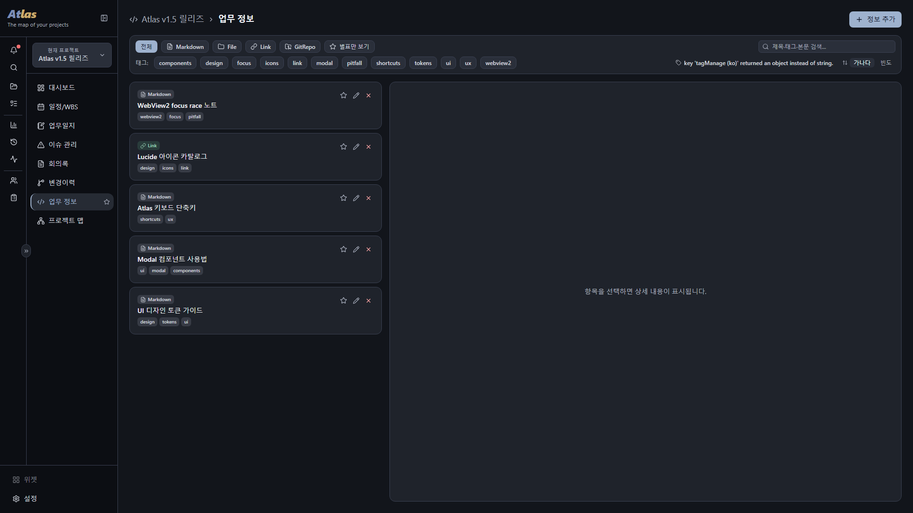

프로젝트에 딸린 자료는 **업무 정보**로 묶습니다. 마크다운 문서, 파일, 외부 링크, 그리고 **깃 저장소**까지. 저장소를 등록해 두면 커밋 이력을 그래프로 보여 줘서, 코드와 프로젝트 기록이 한자리에서 만납니다.

### 프로젝트 맵 — 모든 것이 어떻게 연결되는지

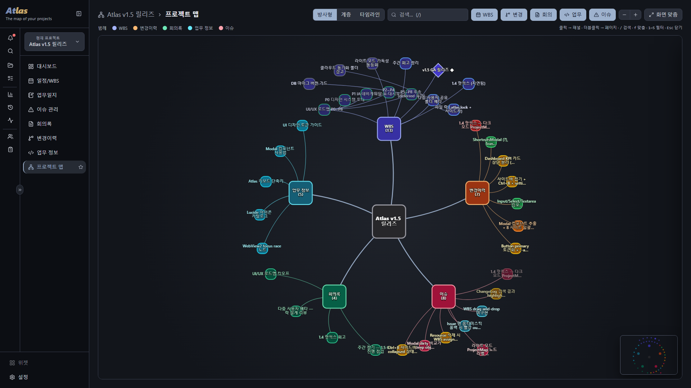

"한 장의 지도"라는 이름이 가장 잘 드러나는 화면입니다. WBS·이슈·회의·변경·자료 사이의 관계를 그래프로 시각화합니다. 이 작업이 어떤 이슈에서 나왔고, 어떤 회의에서 결정됐고, 어떤 자료에 기대고 있는지 — 선을 따라가며 프로젝트의 얼개를 눈으로 짚습니다.

### 통합 모니터링 — 전 프로젝트를 한눈에

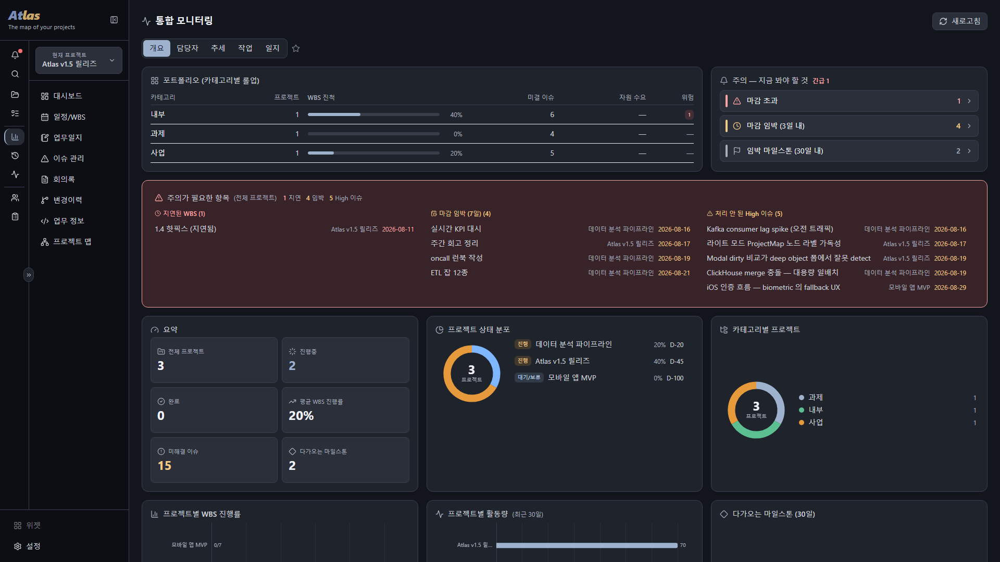

프로젝트 하나에서 빠져나와, 모든 프로젝트를 한 화면에서 내려다봅니다. 프로젝트 상태 분포, 이슈 상태×우선순위, 다가오는 30일 마일스톤, 프로젝트별 진행률, 그리고 담당자×마감 히트맵까지. "전체적으로 지금 어디에 불이 났나"를 한 번에 봅니다.

### 업무 일지

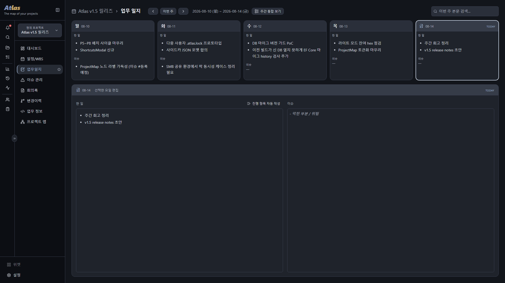

하루하루는 **업무 일지**에 "한 일 / 계획 / 이슈"로 남깁니다. 주 단위로 마크다운 내보내기도 됩니다. 작업 상태를 바꾸면 그날 일지에 자동으로 흔적이 남아서, 따로 적지 않아도 기록이 쌓입니다.

## 내 취향대로 — 테마·언어·백업

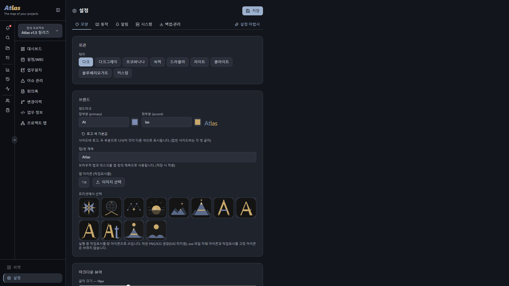

오래 쓰는 도구일수록 손에 맞아야 합니다. 다크/라이트에 **12색 커스텀 테마**(핵심 색만 고르면 나머지는 자동으로 파생), **한국어·영어 전환**, 마크다운 글자 크기·줄간격, 그리고 전체 데이터를 지정 폴더로 주기적으로 압축하는 **자동 백업**까지 갖췄습니다.

## 설치하기

Atlas 는 Microsoft Store 에서 **"Atlas-Project Manager"**(게시자 SlnU)로 설치할 수 있습니다. 설치와 업데이트가 자동으로 관리되고, 별도 관리자 권한도 필요 없습니다.

  <a href="https://apps.microsoft.com/detail/9NMW5KS7HD1R?hl=ko-kr&gl=KR"><strong>▶ Microsoft Store 에서 Atlas 설치하기</strong></a>

혼자서 여러 프로젝트를 굴리는 분, 데이터를 클라우드에 올리고 싶지 않은 분, 전체를 한 화면에서 보고 싶은 분이라면 한 번 지도를 펼쳐 보시길.

---

🗺️ **다음 편** — [② 만든 이야기: 프로젝트 관리 앱을, 그 앱으로 만들었습니다]()
