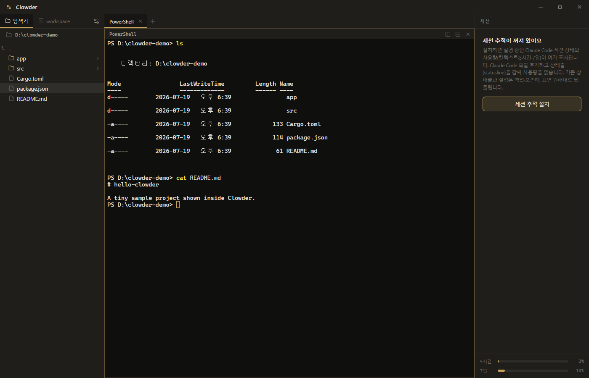

> 여러 Claude Code 세션을 한 화면에서 다루려고 만든 터미널 워크스페이스 이야기.

에이전트에게 일을 맡기는 게 익숙해지면, 자연스럽게 **한 번에 여러 개**를 돌리게 됩니다. 이건 리팩터링, 저건 테스트 보강, 그 옆은 문서 정리… 세 개쯤 띄워 놓고 나면 화면이 이상해집니다. 창이 흩어지고, 어느 창이 제 승인을 기다리는지 몰라 `Alt+Tab` 을 두 바퀴 돌리고, 방금 뭘 물어봤는지 보려고 또 한 바퀴. 정작 모델은 잘 돌고 있는데 **제가 병목이 되어 있는** 겁니다.

바이브 코딩이라 부르든 에이전틱 코딩이라 부르든, 해 보면 제일 자주 걸리는 건 모델의 실력이 아니었습니다. **여러 에이전트를 동시에 굴릴 자리가 없다**는 것이었습니다. 마땅한 게 없어서 직접 만들었고, 그게 Clowder 입니다.

## 병목은 모델이 아니라 창이었습니다

VS Code 로 대부분은 됩니다. 그런데 두 가지가 막혔습니다. **탐색기가 열어 둔 폴더에 묶여 있고**, 실행 중인 **세션 상태를 붙일 자리가 없습니다.** 에이전트를 여러 프로젝트에 걸쳐 굴리려면 어디든 자유롭게 뒤져야 하는데 workspace 라는 울타리를 매번 다시 세워야 했고, 세션이 지금 무슨 상태인지는 편집기가 알 이유가 없는 정보였습니다. Windows Terminal 은 pane 에 터미널만 담을 수 있어 원리적으로 다른 걸 넣을 수 없습니다.

그래서 Clowder 는 **터미널을 중심에 두고 그 주변을 채우는** 쪽으로 갔습니다. 탭과 타일링 터미널이 가운데, 왼쪽에 전체 파일 탐색기, 오른쪽에 지금 필요한 패널. 한 창 안에서, 각자 자기 영역을 지키면서.

## 지금 저를 기다리는 건 어느 세션인가

병렬로 돌릴 때 가장 아픈 지점은 **human-in-the-loop** 입니다. 에이전트는 언젠가 사람에게 묻습니다 — 이 파일을 지워도 되냐, 이 명령을 실행해도 되냐. 그 순간을 놓치면 세션 하나가 조용히 멈춰 서 있습니다. 셋을 돌리면 셋 다 멈춰 있어도 모릅니다.

우측 레일의 **세션 패널**이 그걸 보여줍니다.

- **상태** — 승인 대기 · 대기 중 · 동작 중 · 유휴. 저를 기다리는 세션이 위로 올라옵니다.
- **서브에이전트** — 한 세션이 서브에이전트를 띄우면 그 트리까지 같이 보입니다.
- **사용량** — 컨텍스트가 얼마나 찼는지, 5시간·7일 한도가 어디쯤인지.

행을 클릭하면 그 세션이 돌고 있는 터미널로 갑니다. "어느 창이었지"를 없애는 게 목적이었습니다. 강요하지는 않습니다 — 쓰겠다고 버튼을 누를 때 설치되고, 기존 Claude Code 설정은 백업되며, 끄면 원래대로 돌아갑니다.

## 우측 레일은 고르는 공간 — 모든 패널은 터미널로 돌아옵니다

처음엔 우측이 세션 전용이었습니다. 쓰다 보니 터미널 옆에 있으면 좋을 게 세션만이 아니었습니다. 포트가 점유돼 서버가 안 뜰 때, git 상태를 눈으로 보고 싶을 때, 컨테이너에 붙어야 할 때…

- **포트** — 열려 있는 포트와 그걸 쥔 프로세스. 클릭 한 번으로 종료합니다.
- **Git** — 활성 터미널 폴더의 브랜치와 변경 상태. 터미널에서 `cd` 하면 따라옵니다.
- **SSH** — `~/.ssh/config` 의 호스트를 클릭하면 접속된 터미널이 열립니다.
- **Docker · 쿠버네티스** — 컨테이너 시작·정지·exec·로그, 컨텍스트 전환과 파드 exec.
- **작업 · 스니펫** — 폴더의 npm·Make·just 스크립트 실행, 자주 쓰는 명령 저장.

관통하는 원칙이 하나 있습니다. **모든 패널의 동작은 터미널로 돌아옵니다.** SSH 접속도, 파드 exec 도, 스크립트 실행도 자체 UI 가 아니라 **터미널 페인**에서 열립니다. 패널은 런처이고, 일은 터미널이 합니다. 그래야 에이전트에게 넘기든 제가 이어 가든 같은 자리에서 계속할 수 있습니다.

안 쓰는 도구의 패널은 **스스로 숨습니다.** `kubectl` 이 없는 컴퓨터에는 쿠버네티스 탭이 뜨지 않습니다.

## 터미널이 진짜 터미널이어야 합니다

껍데기만 터미널인 것들에 여러 번 데였습니다. 그래서 여기는 타협하지 않았습니다.

**한글이 깨지지 않습니다.** 그리고 **터미널은 죽지 않습니다** — 탭을 옮기고, 페인을 분할하고, 끌어다 옮겨도 셸은 살아 있습니다. 에이전트가 10분째 돌고 있는 세션을 레이아웃 정리하다 날리면 안 되니까요. **전체화면 TUI 에서도 복사가 됩니다.** Claude Code 를 전체화면으로 쓸 때 드래그로 선택하면 그 영역이 그대로 클립보드로 옵니다.

**탐색기는 폴더에 갇히지 않습니다.** 드라이브 루트부터 원하는 데까지 내려가고, 폴더에서 바로 터미널을 엽니다. 에이전트가 만든 보고서는 그 자리에서 문서 뷰어로 읽습니다.

## 계정도, 서버도 없이

Clowder 는 **100% 오프라인·로컬 전용**입니다. 로그인이 없고, 원격 서버로 아무것도 보내지 않습니다. 설정도 세션 정보도 제 PC 안에 그대로 있습니다.

에이전틱 코딩 도구를 쓰다 보면 내 코드가 어디까지 흘러가는지 신경이 쓰입니다. 적어도 **그걸 담는 그릇만큼은** 그럴 필요가 없어야 한다고 생각했습니다.

---

에이전트를 하나 돌릴 때는 창 하나로 충분합니다. 그런데 둘, 셋이 되면 갑자기 **자리를 만드는 일**이 본업처럼 됩니다. 저는 그 자리를 만드느라 한참을 썼고, 이제는 세션 셋을 띄워 놓고도 어느 것이 저를 기다리는지 한눈에 봅니다. 병목이 저였다는 걸 인정하는 데서 시작한 앱입니다.

  <a href="https://apps.microsoft.com/detail/9N4795KFCRC3"><strong>▶ Microsoft Store 에서 Clowder 설치하기</strong></a>

