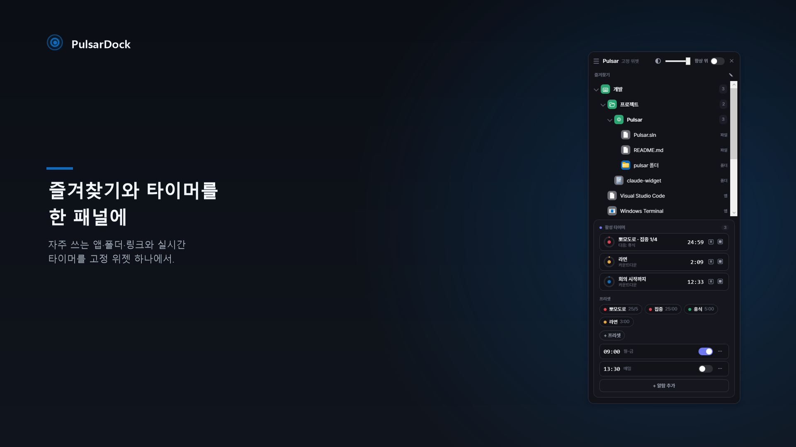
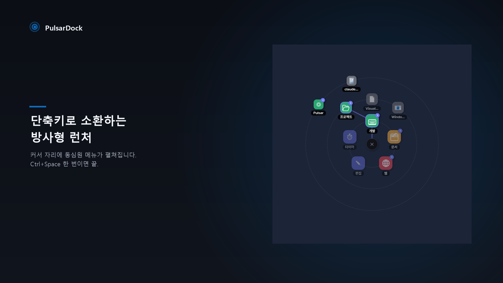
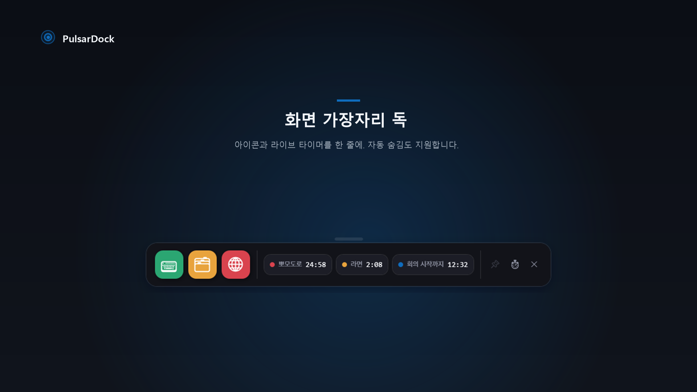
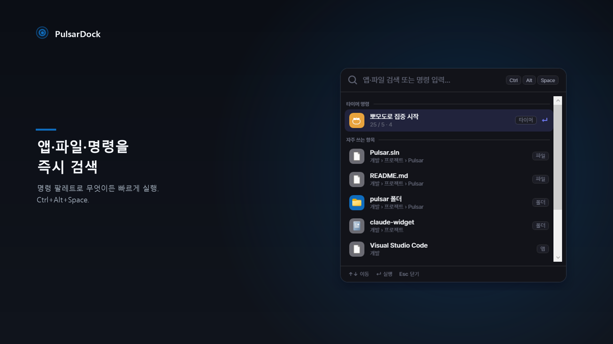
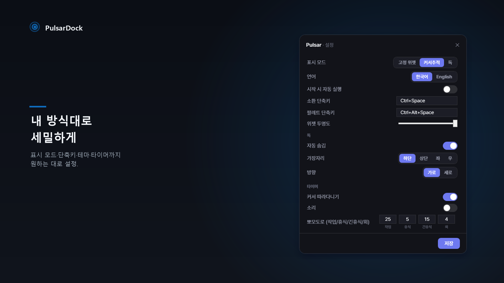

> 하나의 데이터, 네 개의 성격 — 제가 만든 데스크톱 런처 **Pulsar** 이야기입니다.

🗺️ **PulsarDock 이야기** · **① 네 가지 모드** · [② 타이머]()

---

즐겨찾기, 어디에 두고 사세요? 누구는 바탕화면 구석에 아이콘 바를 띄워 두고, 누구는 단축키를 눌러 목록을 불러내고, 누구는 그냥 검색창에 이름 몇 글자를 칩니다. 저도 런처를 하나 만들어 보려고 앉았는데, 정작 첫 줄부터 막히더군요. 기능이 아니라 **"그래서 이걸 어떻게 꺼낼 건데?"** 에서요.

주변에 물어봤더니 답이 다 달랐습니다. macOS 를 쓰던 친구는 화면 아래 독이 없으면 허전하다 하고, 어떤 분은 화면을 가리는 건 질색이라 커서 옆에 잠깐 떴다 사라지길 원하고, 키보드에서 손을 떼기 싫은 개발자는 "그냥 검색해서 엔터"면 된다 합니다. 취향은 하나로 안 모였습니다. 한참을 고르다가, 결국 **안 골랐습니다.** 네 개를 다 만들었거든요. 그게 Pulsar(스토어 이름 **PulsarDock**)입니다.

Pulsar 는 자주 쓰는 앱·파일·폴더·링크와 타이머를 하나로 묶어 두는, 트레이에 상주하는 Windows 데스크톱 런처입니다. `WPF · .NET 8`, 그리고 **100% 로컬**. 특별한 건, 같은 즐겨찾기를 **네 가지 방식으로 꺼낼 수 있다**는 점입니다.

## 하나로 못 골라서, 그래서 안 골랐습니다 — 하나의 데이터, 네 개의 화면

네 가지를 각각 따로 만들면, 그건 그냥 앱이 네 개입니다. 즐겨찾기를 네 군데에 등록하고, 하나 바꾸면 네 번 고치고… 생각만 해도 지치는 일이죠.

그래서 처음부터 원칙을 하나 세웠습니다. **데이터와 엔진은 하나, 갈아끼우는 건 화면뿐.** 즐겨찾기 트리도, 타이머도 밑바닥에선 딱 한 벌만 존재합니다. 그 위에 "어떻게 보여 줄지"만 `DisplayMode` 하나로 바꿔 끼웁니다. 그러니 내 즐겨찾기를 한 번만 정리해 두면, 오늘은 독으로 꺼내 쓰다가 내일은 방사형으로 바꿔도 **그대로 따라옵니다.** 취향은 화면의 문제이지, 데이터의 문제가 아니니까요.

네 개의 성격을 하나씩 소개하겠습니다.

## 늘 거기 있는 대시보드 — 고정 위젯

항상 눈에 보여야 안심이 되는 분을 위한 모드입니다. 화면 한켠에 패널을 띄워 두면 즐겨찾기 계층과 지금 돌아가는 타이머가 늘 거기 있습니다. **투명도를 낮춰** 배경에 은은하게 깔아 둘 수도, **항상 위**로 고정할 수도, 그냥 손으로 **끌어다** 원하는 자리에 놓을 수도 있습니다. "위젯"이라는 말이 가장 잘 어울리는, 상주형 대시보드입니다.

## 커서 옆으로 불러내는 방사형 — 커서추적

반대로, 화면을 뭔가가 차지하고 있는 걸 못 견디는 분도 있습니다. 이 모드는 평소엔 아무것도 없다가 `Ctrl+Space` 한 번이면 **커서 바로 그 자리에** 동심원 메뉴가 확 펼쳐집니다. 그룹으로 들어가면 안쪽 링은 그대로 둔 채 바깥으로 링이 하나 더 돋는 식이라, 내가 어느 갈래를 타고 들어왔는지 시선을 잃지 않습니다. 가운데는 오직 닫기(✕) 하나뿐 — 원하는 걸 고르면 스르륵 사라집니다. **필요할 때만 나타나는** 런처를 좋아한다면 이쪽입니다.

## 가장자리에 착 붙는 아이콘 바 — 독

macOS 의 독이 손에 익은 분이라면 이 모드가 집처럼 편할 겁니다. 화면 가장자리(아래·위·좌·우 어디든)에 아이콘 바가 착 붙고, 마우스가 다가오면 그 자리를 지키며 아이콘이 부드럽게 부풀어 오릅니다. **자동 숨김**을 켜 두면 평소엔 살짝 숨어 있다가 가장자리로 커서를 가져갈 때만 슬며시 올라옵니다. 바 끝에는 지금 돌아가는 타이머가 칩으로 붙고요.

## 손이 키보드를 안 떠나는 사람에게 — 명령 팔레트

그리고 네 번째. 사실 이건 위 세 모드와 **나란한 게 아니라 직교**합니다. 어떤 표시 모드를 쓰고 있든, `Ctrl+Alt+Space` 를 누르면 화면 한가운데에 검색창이 뜹니다. 앱 이름 몇 글자를 치면 퍼지 검색으로 후보가 좁혀지고, 엔터 한 번에 실행. Spotlight 나 PowerToys Run 이 손에 익은 분에게, 마우스는 거들 뿐입니다. (여기 검색창은 타이머 명령도 알아듣는데, 그 얘기는 [다음 편]()으로 아껴 두겠습니다.)

## 취향은 더 잘게 갈라집니다

꺼내는 방식만 취향인 건 아니더군요. 그래서 결을 몇 겹 더 뒀습니다.

- **두 개의 다른 얼굴** — 라이트는 Windows 11 의 Fluent, 다크는 Linear 계열로, 두 테마를 아예 **다른 인상**으로 그렸습니다. 어디서 많이 본 "generic 한 AI 앱 느낌"을 피하고 싶었거든요. 시스템 강조색도 자연스럽게 따라옵니다.
- **아이콘도 내 마음대로** — 파일에서 자동 추출하거나, 이모지 하나(🍅), 직접 넣은 이미지, 아니면 글자 한두 개의 모노그램까지. 네 가지 중에 고릅니다.
- **한국어 · English** — 설정에서 언어를 바꾸면 재시작 없이 그 자리에서 UI 가 바뀝니다.

설정 화면에 제가 붙여 둔 캡션이 하나 있는데, 이 글의 정신을 그대로 옮긴 말이라 좋아합니다 — **"내 방식대로, 세밀하게."**

## 모드를 바꿔도, 내 즐겨찾기는 그대로

돌아보면, 네 개를 만든 것보다 **하나로 묶은 것**이 더 중요한 결정이었습니다. 모드는 설정에서 한 줄로 바꾸는 스위치일 뿐이라, 오늘의 기분과 지금 하는 일에 따라 성격만 갈아입힙니다. 그래도 밑에 깔린 내 즐겨찾기와 타이머는 흔들리지 않고요.

그리고 이 모든 건 **내 PC 안에서만** 일어납니다. 설정도 즐겨찾기도 타이머도 `%APPDATA%\Pulsar` 안 JSON 몇 개에 담길 뿐, 수집도 전송도 네트워크도 없습니다. 취향을 잔뜩 등록해 두는 앱일수록, 그 취향이 밖으로 안 나가는 게 중요하다고 생각했습니다.

## 설치하기

Pulsar 는 Microsoft Store 에서 **PulsarDock**(게시자 SlnU)으로 설치할 수 있습니다. 설치와 업데이트가 자동으로 관리되고, 별도 관리자 권한도 필요 없습니다.

  <a href="https://apps.microsoft.com/detail/9NLVDQ785190?hl=ko-kr&gl=KR"><strong>▶ Microsoft Store 에서 PulsarDock 설치하기</strong></a>

취향을 하나로 못 고른 건, 돌아보니 약점이 아니라 이 앱의 생김새가 됐습니다. 당신의 취향은 넷 중 무엇인가요 — 아니면, 그날그날 다른가요?

---

🗺️ **다음 편** — [② 타이머: 상주하니까, 타이머도 됩니다]()
