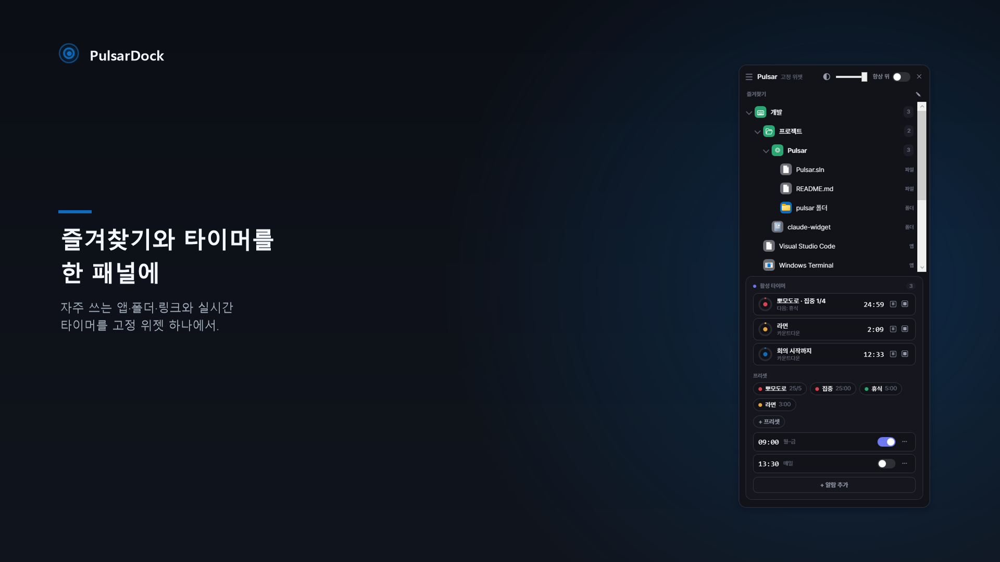
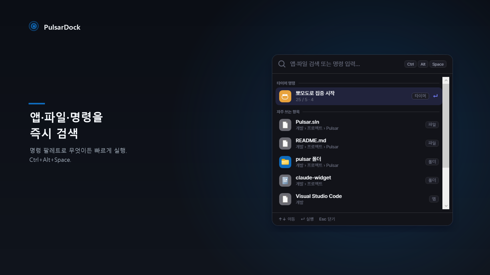
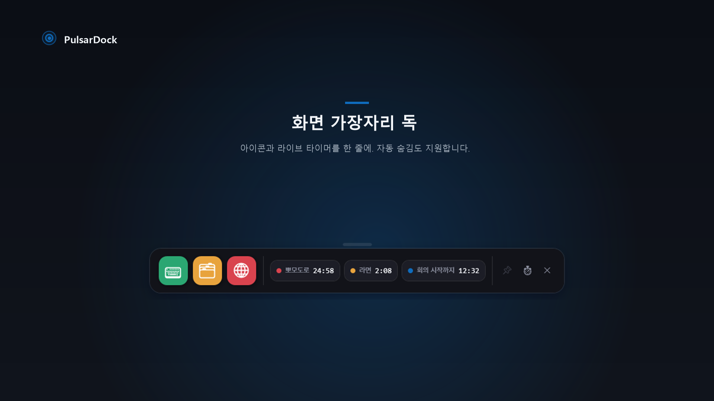

> 항상 트레이에 떠 있는 앱의 두 번째 정체성 — Pulsar 의 타이머 이야기입니다.

🗺️ **PulsarDock 이야기** · [① 네 가지 모드]() · **② 타이머**

---

"25분만 집중하자" 하고 타이머를 켜려는데, 그 타이머가 어디 있죠? 폰은 책상 저쪽에 엎어져 있고, 브라우저에 열어 둔 뽀모도로 탭은 어느새 스무 개째 탭 뒤로 밀려나 있고, 주방 타이머는… 주방에 있습니다. 정작 하루 종일 제 눈앞에 켜져 있는 건 이 PC 인데, 그 PC 에는 마땅한 타이머가 없더군요. 게다가 폰 타이머를 끄러 손을 뻗는 순간 그 폰이 저를 유튜브로 데려가는 것도, 솔직히 한두 번이 아니었습니다.

[지난 글]()에서 즐겨찾기를 네 가지 방식으로 꺼내는 런처 **Pulsar** 를 소개했습니다. 그런데 이 앱을 만들다 문득 이런 생각이 들었습니다. **"얘는 어차피 항상 켜져 있잖아?"** 트레이에 상주하며 단축키만 기다리는 앱이라면, 타이머 하나쯤은 공짜로 얹을 수 있겠다고요. 그렇게 Pulsar 는 런처이면서 타이머가 됐습니다.

다만 "항상 켜져 있는 타이머"가 쓸모 있으려면, 넘어야 할 문턱이 하나 있었습니다. **믿을 수 있어야 한다는 것.**

## 끝나는 '시각'을 붙잡아 둡니다 — 잠들어도, 시계를 바꿔도

평범한 카운트다운은 초를 하나씩 세어 내려갑니다. 문제는 노트북이 잠들거나 앱이 잠깐 멈칫하면 그 세던 숫자가 어긋난다는 것. 옆에서 숫자를 세어 주던 사람이 잠깐 졸면 카운트가 틀어지는 것과 똑같습니다.

그래서 Pulsar 는 초를 세지 않습니다. 대신 **"이 타이머는 2시 47분에 끝난다"**는, 끝나는 **시각**을 적어 둡니다. 그리고 그저 시계를 힐끗 봅니다 — 남은 시간은 언제나 '끝나는 시각 − 지금'. 노트북이 한 시간을 자다 깨어나도, 깨어나는 그 순간 시계를 보고 정확한 남은 시간을 다시 셈합니다. 어긋날 틈이 없습니다.

시스템 시계를 손으로 바꾸거나 절전에서 돌아올 때는 알람을 조용히 **다시 무장**합니다. 엉뚱한 순간에 울리거나, 울려야 할 때 침묵하는 일이 없도록요. 덤으로, 그래서 **앱을 껐다 켜도 타이머는 살아 있습니다.** 끝나는 시각을 알고 있으니 다시 열면 그때까지 얼마 남았는지 스스로 되찾거든요. 초를 세는 대신 시각을 붙잡아 둔 덕분입니다.

## 라면과 빨래와 회의를 한꺼번에 — 세 가지 얼굴

타이머 하나로는 삶이 안 굴러갑니다. 라면 3분, 빨래 40분, 회의까지 12분 — 이것들은 동시에 흘러야죠. 그래서 Pulsar 는 여러 타이머를 한꺼번에 돌리고, 각각을 **색과 이름**으로 구분합니다.

그리고 타이머는 세 가지 얼굴을 가집니다.

- **카운트다운** — "3분 뒤" 같은, 그냥 지정한 시간.
- **뽀모도로** — 집중 25분 → 휴식 5분 → 다시 집중… 을 **알아서 넘어갑니다.** 네 번 돌면 긴 휴식 15분. (다 기본값이고, 전부 바꿀 수 있습니다.)
- **알람** — 벽시계 시각에 맞춘 알림. "매일 09:00", "월–금 09:00" 처럼 요일 반복도 됩니다.

자주 쓰는 건 **프리셋**으로 저장해 한 번에 시작합니다 — 집중 `25:00`, 휴식 `5:00`, 그리고 제가 특히 아끼는 라면 `3:00` 까지. 네, 진짜 라면 타이머 맞습니다.

## "25분" 이라고 치면 됩니다 — 말로 거는 타이머

1편에서 소개한 명령 팔레트 기억하시나요. 여기에 타이머를 얹었습니다. `Ctrl+Alt+Space` 를 누르고 그냥 **"25분"** 이라고 치면 25분 카운트다운이 걸립니다. **"뽀모도로"** 라고 치면 뽀모도로가 시작되고, **"알람 7:00"** 이면 7시 알람이 추가됩니다. 프리셋 이름을 치면 그 프리셋이 후보로 뜨고요.

타이머를 걸겠다고 마우스로 버튼을 찾아 헤맬 필요가 없습니다. 검색하듯 말하면 됩니다.

## 거슬리지 않게, 딱 필요한 만큼만 — 조용한 타이머

타이머 앱의 흔한 실수는 존재감이 너무 크다는 것입니다. 트레이 아이콘에 숫자를 박고, 작업표시줄에 진행 막대를 깔고, 큼직한 토스트를 연신 띄우고… 저는 일부러 반대로 갔습니다.

- 트레이 아이콘에는 **남은 시간 숫자를 넣지 않았습니다.** 아이콘은 그저 소환 버튼입니다.
- 작업표시줄 진행 막대도 **쓰지 않습니다.**
- 타이머는 지금 쓰는 모드에 자연스럽게 얹힙니다 — 고정 위젯이면 목록으로, 커서 모드면 커서를 따라다니는 작은 **알약**으로(클릭은 그대로 밑으로 통과합니다), 독이면 바 끝의 **칩**으로.
- 다 되면 시끄러운 시스템 토스트 대신 **앱 안의 작은 플라이아웃**으로 알립니다.

필요할 땐 곁눈에 걸리고, 아닐 땐 없는 듯이. 하루 종일 떠 있는 앱이 지켜야 할 예의라고 생각했습니다.

## 설치하기

Pulsar 는 Microsoft Store 에서 **PulsarDock**(게시자 SlnU)으로 설치할 수 있습니다. 설치와 업데이트가 자동으로 관리되고, 별도 관리자 권한도 필요 없습니다.

  <a href="https://apps.microsoft.com/detail/9NLVDQ785190?hl=ko-kr&gl=KR"><strong>▶ Microsoft Store 에서 PulsarDock 설치하기</strong></a>

돌아보면 타이머는 따로 큰맘 먹고 만든 기능이 아니라, **항상 켜져 있는 앱이 자연스럽게 갖게 된 두 번째 정체성**이었습니다. 라면 물을 올리고 이 글을 닫는 지금 이 순간에도, 3분짜리 하나가 어딘가에서 조용히 돌고 있습니다.

---

🗺️ **처음으로** — [① 네 가지 모드: 취향을 못 골라서, 네 개를 다 만들었습니다]()
