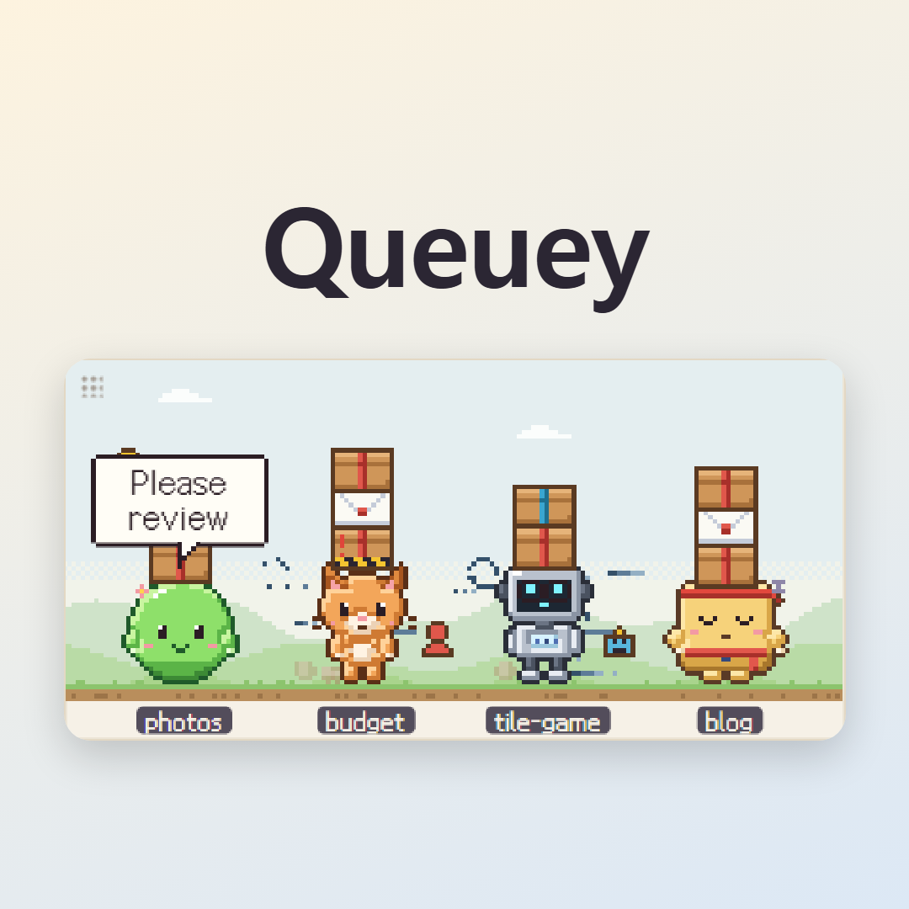
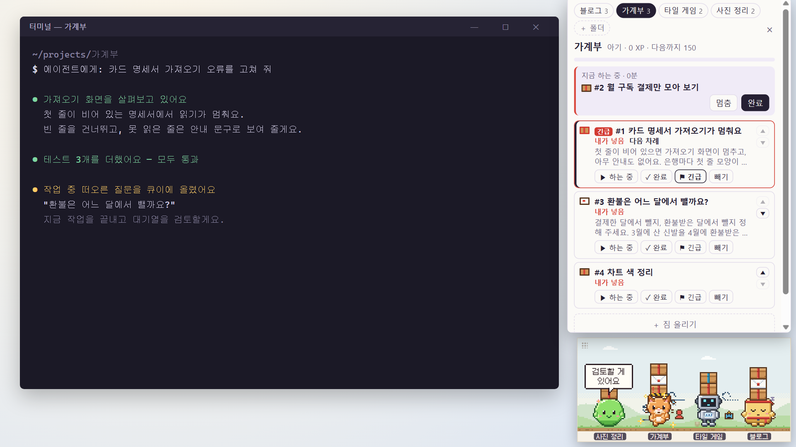
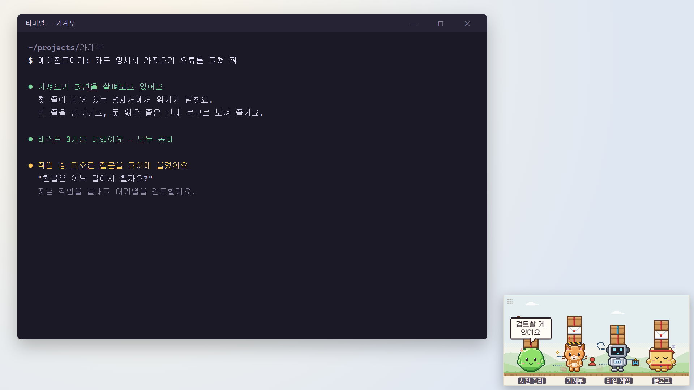
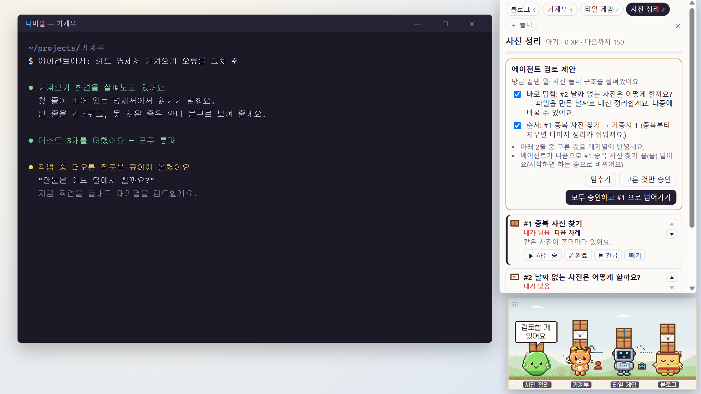
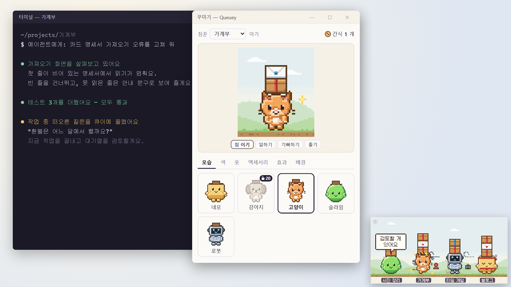

> 세션 하나에 끼어드는 말들이 아까워서 만든 작은 앱.

저는 에이전트와 일할 때 **프로젝트마다 세션을 딱 하나씩** 엽니다. 한 저장소에 세션 여럿을 풀어 두면 서로 같은 파일을 건드리고, 제가 검토해야 할 범위가 감당 못 할 만큼 불어나기 때문입니다. 그래서 늘 한 프로젝트, 한 세션, 한 흐름.

문제는 그 흐름이 도는 동안에도 머리는 쉬지 않는다는 것입니다. Claude Code 가 한창 리팩터링을 하는 사이에 "아, 이거 끝나면 저것도 해야지", "그런데 그 설정은 확인해 봤나?" 같은 생각이 계속 떠오릅니다. 그걸 참지 못하고 중간중간 입력창에 던져 넣다 보면… 어느 순간 **세션의 컨텍스트가 오염되는 느낌**이 듭니다. 지금 하던 일과 상관없는 말이 대화 한가운데 끼어 있으니까요.

떠오른 건 놓치기 싫고, 지금 세션은 깨끗하게 두고 싶었습니다. 그래서 그 사이에 둘 자리를 만들었습니다. **큐이(Queuey)** 입니다.

## 투두앱이 아니라 — "다음 일"의 자리

처음엔 있는 걸로 해결하려 했습니다. 직접 만든 프로젝트 관리 도구에도, 투두앱에도 MCP 를 붙여 에이전트가 읽고 쓰게 해 봤습니다. 그런데 써 볼수록 어긋났습니다. **전체 업무와, 에이전트가 지금 붙들고 있는 세부 항목은 결이 다르다**는 것.

프로젝트 관리 도구에 들어갈 일은 "이번 달에 결제 기능 붙이기" 같은 덩어리입니다. 반면 세션 옆에 쌓이는 건 "카드 명세서 첫 줄이 비면 멈추는 거 보기", "환불은 어느 달에 넣을지 물어보기" 같은, 몇십 분짜리 다음 할 일과 질문들입니다. 이 작은 것들에 맞는 자리가 따로 필요했습니다.

## 한 줄로 세우기 — 하는 중은 하나만

큐이의 바탕은 단순한 **대기열**입니다. 프로젝트마다 할 일과 질문을 줄 세워 두고, 그중 **지금 하는 일은 딱 하나**만 둡니다. 급한 건 `긴급`으로 앞에 세우고, 순서는 언제든 제가 바꿉니다.

일하다 생각이 떠오르면 세션에 말을 거는 대신 큐이에 한 줄 적어 둡니다. 세션이 하던 일을 끝내면 그때 줄 맨 앞의 것을 꺼내면 됩니다. 세션은 깨끗하게, 생각은 안전하게.

## 귀여우니까 — 짐을 지는 짐꾼

목록만 있었다면 그냥 또 하나의 할 일 앱이었을 겁니다. 큐이에는 화면 오른쪽 아래에 **픽셀 짐꾼**이 삽니다. 프로젝트마다 한 명씩 서서, 쌓인 일을 머리에 짐으로 이고 있습니다.

이유를 솔직히 말하면 — **귀여우니까요.** 그리고 일이 쌓인다는 걸 숫자가 아니라 눈으로 보고 싶었습니다. 짐이 높아지면 짐꾼도 힘들어 보이고, 일을 시작하면 바쁘게 움직이다가, 끝내면 짐을 내려놓습니다. 그 모습을 보는 게 생각보다 꽤 즐겁습니다.

하는 일이 너무 길어지면 짐꾼이 "아직 하고 있어요?" 하고 묻기도 합니다. 계속할 거면 `계속할게요` 를 누르면 됩니다.

## 정하는 건 사람 — 에이전트는 줄 맨 뒤에

큐이는 MCP 로 에이전트와도 연결됩니다. 에이전트도 같은 줄에 할 일과 질문을 올릴 수 있습니다. 다만 규칙이 하나 있습니다. **에이전트는 줄 맨 뒤에만 설 수 있습니다.**

순서를 바꾸거나 긴급으로 올리고 싶으면 에이전트는 **제안**을 합니다. "이 질문엔 이렇게 답하고, 이건 앞으로 당기는 게 좋겠어요 — 중복부터 지우면 나머지가 쉬워지니까요." 그러면 제가 보고 승인하거나 거절합니다.

저는 **모든 결정은 사람이 확인해야 한다**고 생각합니다. 에이전트가 줄을 마음대로 다시 세우는 순간, 그 줄은 더 이상 제 것이 아니게 되니까요. 대신 귀찮은 일 — 다음 일을 정리하고, 순서를 검토하고, 이유를 붙이는 일 — 은 에이전트에게 맡깁니다. 고르는 건 제가 하고요.

## 몰래 보지 않는 앱

큐이는 사실 한 번 버리고 다시 만든 앱입니다. 첫 판은 화면 위를 떠다니는 투명한 창에, 마우스가 그냥 통과하는 짐꾼이었습니다. 저는 그 판이 정말 마음에 들었고, 지금도 아쉽습니다.

그런데 그 방식은 보안 프로그램이 깔린 PC 에서 의심받기 딱 좋은 모양이었습니다. 저는 **회사 같은 보안 환경에서도 걱정 없이 켜 둘 수 있는 앱**을 만들고 싶었습니다. 아까운 것보다 매일 쓰고 싶은 마음이 더 컸습니다. 그래서 원칙을 정하고 처음부터 다시 만들었습니다.

- **입력을 보지 않습니다** — 키보드·마우스·활성 창 감시가 없습니다.
- **아무것도 실행하지 않습니다** — 다른 프로그램을 띄우지 않습니다. git 조차 실행하지 않고 `.git` 폴더를 직접 읽습니다.
- **밖으로 나가지 않습니다** — 에이전트 연결은 내 PC 안(`127.0.0.1`)에서만 열립니다. 계정도, 서버도 없습니다.

## 간식과 꾸미기, 그리고 앞으로

일을 끝내면 짐꾼이 간식을 받습니다. 모은 간식으로 짐꾼의 모습을 바꾸고, 옷을 입히고, 배경을 고를 수 있습니다. 강아지, 고양이, 슬라임, 로봇까지.

아직 더 써 봐야 알겠지만, 앞으로는 **직접 그린 모습**도 짐꾼으로 쓸 수 있게 해 보고 싶습니다.

세션은 하나, 머릿속은 여럿. 그 사이에 줄 하나를 세워 두니, 이제야 떠오른 생각들을 마음 놓고 미뤄 둘 수 있게 됐습니다.

  <a href="https://apps.microsoft.com/detail/9PNV73XF9B4N?hl=ko-kr&gl=KR"><strong>▶ Microsoft Store 에서 큐이 설치하기</strong></a>

