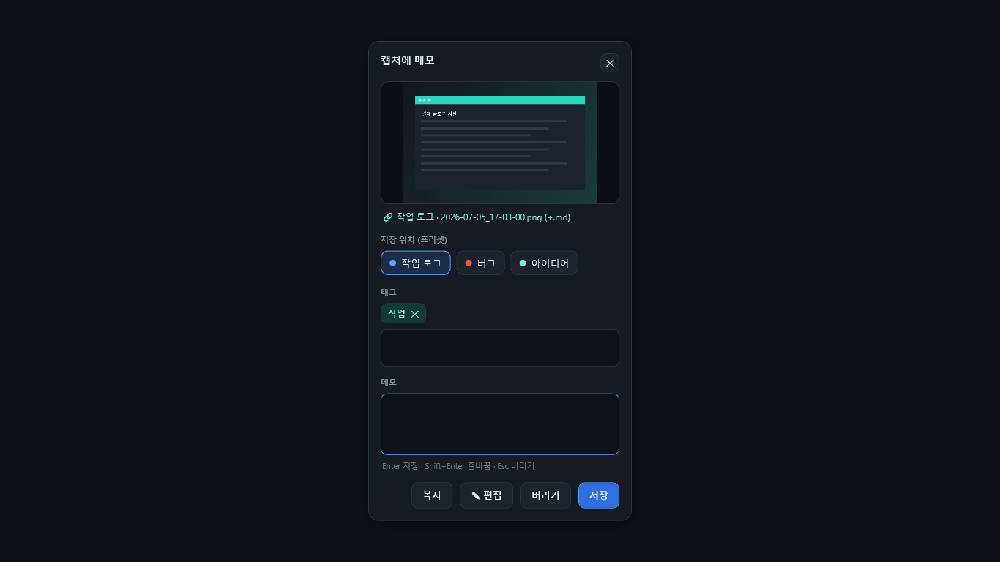
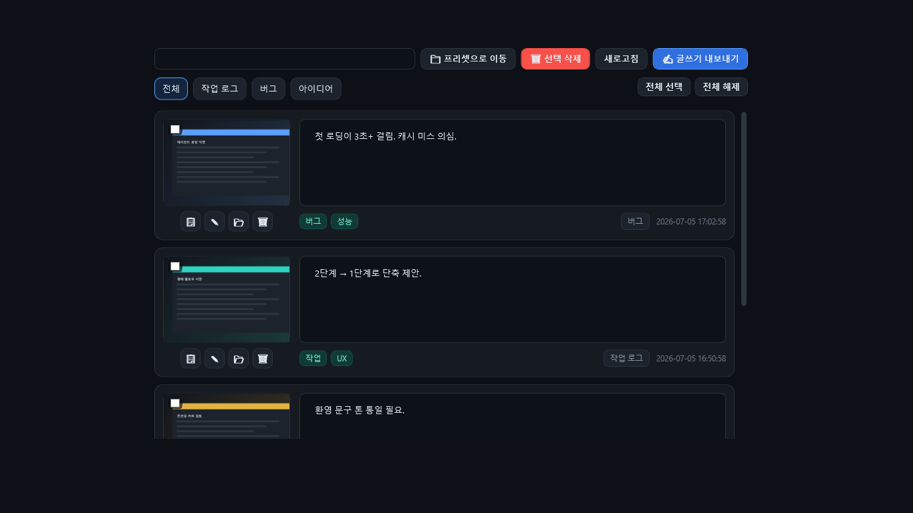
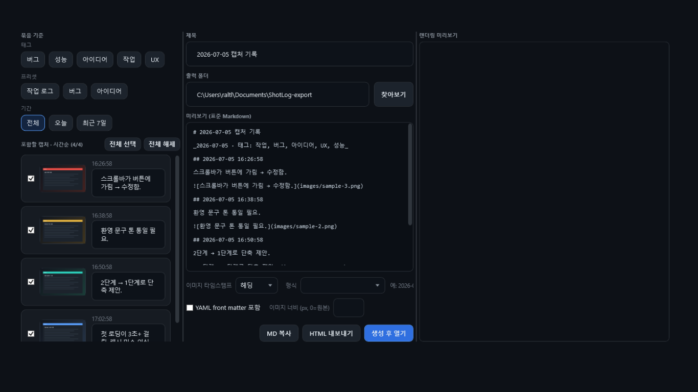
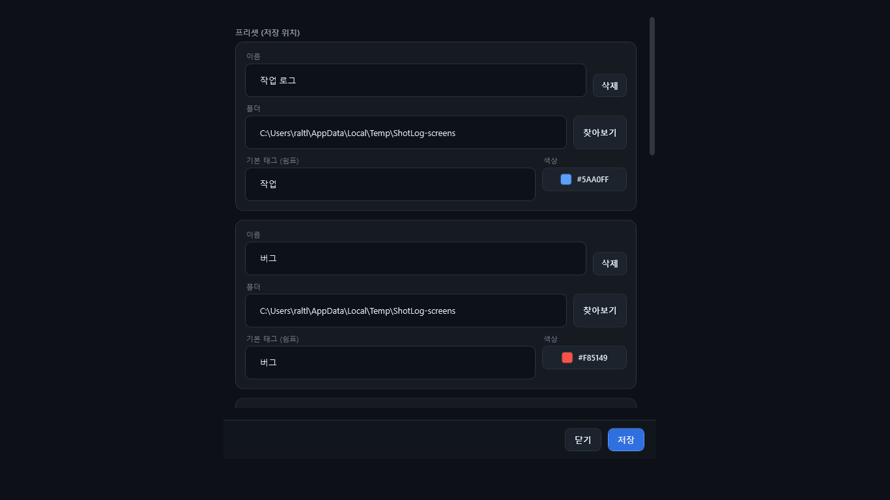

> 화면을 찍는 순간, 그 생각도 같이 붙잡아 두는 도구를 만들었습니다.

🗺️ **ShotLog 이야기** · **① 소개** · [② 업데이트 함정]() · [③ fail-soft 의 뒷면]() · [④ 스스로 찍는 스크린샷]()

---

스크린샷 폴더를 열어 봅니다. `Screenshot (47).png`, `Screenshot (48).png`, `스크린샷 2026-06-12 143052.png`… 스무 장, 서른 장. 분명 하나하나 이유가 있어서 찍었을 겁니다. 그런데 지금 그 이유를 한 장도 기억하지 못하겠더군요.

이상한 일입니다. 화면은 픽셀 하나 안 틀리고 그대로 남아 있는데, **왜 찍었는지만 사라졌습니다.** 이 오류가 재현된다는 걸 알리려던 건지, 이 UI 가 마음에 들어서였는지, 이 문단을 나중에 인용하려던 건지. 남은 건 증거뿐이고, 증언은 없습니다.

생각해 보면 당연했습니다. 캡처는 0.1초 만에 끝나는데, 그걸 기록으로 만드는 일 — 이름 붙이고, 폴더 나누고, 왜 찍었는지 적어 두는 일 — 은 몇 분이 걸립니다. 그래서 아무도 안 합니다. 저도 안 했고요. **찍는 건 공짜지만 남기는 건 비싸다**는 이 비대칭이, 제 폴더를 이유 없는 이미지 무덤으로 만들고 있었습니다. 마땅한 게 없어서 직접 만들었고, 그게 ShotLog 입니다.

ShotLog 는 트레이에 상주하는 Windows 캡처·메모 도구입니다. `WPF · .NET 8`, 그리고 **네트워크 호출이 단 하나도 없는** 완전 로컬 앱. 하는 일은 한 문장으로 줄어듭니다 — 단축키로 화면을 잡고, 그 자리에서 생각을 적고, 나중에 읽을 수 있는 문서로 꺼냅니다.

## 찍는 순간이, 맥락이 가장 선명한 순간입니다

이 앱의 전제는 하나입니다. **"왜 찍었는지"를 가장 잘 아는 건 찍은 직후의 나**라는 것.

그 순간 저는 이미 문제를 보고 있고, 이미 그 이유를 머릿속에 갖고 있습니다. 10초 뒤면 다음 창으로 넘어가 버릴 그것을요. 하루가 지나면 복원 비용은 수십 배가 되고, 일주일이 지나면 복원이 아예 불가능해집니다. 캡처와 기록 사이의 그 짧은 틈 — 도구가 개입할 수 있는 자리는 거기뿐이었습니다.

그래서 ShotLog 는 캡처가 끝나면 **곧바로 메모 카드를 띄웁니다.** 파일 탐색기를 열지도, 이름을 물어보지도 않습니다. 그냥 한 줄 쓸 자리를 눈앞에 갖다 놓습니다. 안 쓰고 닫아도 그만이지만, 그 자리에 있느냐 없느냐가 결국 전부더군요.

## 그 자리에서 한 줄 — 빠른 메모 카드

단축키를 누르면 화면이 잡히고, 그 위로 작은 카드가 뜹니다. 메모 한 줄, 태그 몇 개, 그리고 **프리셋 칩**. 엔터를 치면 사라집니다. 5초면 끝나는 일입니다.

여기서 제가 특히 아끼는 게 **프리셋** 입니다. 프리셋은 저장 폴더 · 강조 색상 · 기본 태그를 한 덩어리로 묶어 둔 것입니다. `버그` 프리셋을 고르면 버그 폴더로 가고 `bug` 태그가 자동으로 붙고, `학습` 프리셋을 고르면 학습 폴더로 갑니다. 캡처할 때 칩 하나만 누르면 **분류가 이미 끝나 있습니다.** 나중에 정리하겠다는 약속은 지켜진 적이 없으니, 아예 나중을 만들지 않기로 한 겁니다.

저장 전에 화면 위에 **그려 넣을 수도** 있습니다. 펜, 형광펜, 화살표, 사각형, 텍스트. "여기요, 이 버튼이요"를 말로 설명하는 것보다 빨간 동그라미 하나가 빠를 때가 있으니까요. (이미 저장한 캡처도 인박스에서 다시 열어 고칠 수 있습니다.)

## 나중의 나를 위한 받은 편지함

찍어 둔 것들은 **인박스** 로 흘러갑니다. 메일함처럼요.

이름을 이렇게 지은 데엔 이유가 있습니다. 스크린샷 폴더는 **창고**입니다. 한번 들어가면 다시 안 열어 봅니다. 반면 받은 편지함은 **처리하려고 여는 곳**입니다. 열어서, 보고, 지우거나 답하거나 보관합니다. 저는 캡처가 창고가 아니라 편지함에 쌓이길 바랐습니다.

그래서 인박스에서 할 수 있는 일은 전부 "처리"에 관한 것들입니다.

- **인라인 편집** — 썸네일 옆에서 메모와 태그를 바로 고칩니다. 캡처할 땐 급해서 못 쓴 말을, 여유 있을 때 채워 넣습니다.
- **검색과 필터** — 메모·태그로 찾고, 프리셋으로 좁힙니다. "그때 그 오류 화면"을 이름이 아니라 **말로** 찾습니다.
- **정리** — 다중 선택해서 지우거나, 다른 프리셋으로 옮기거나, 클립보드로 복사하거나, 탐색기에서 엽니다.

그리고 원하면 PNG 옆에 같은 이름의 `.md` **사이드카** 를 함께 남겨 둘 수 있습니다. 앱을 지워도, 탐색기에서 파일만 봐도 메모가 거기 있습니다. 제가 만든 앱에 제 기록을 인질로 잡아 두고 싶지 않았습니다.

## 쌓인 캡처를, 읽을 수 있는 문서로

여기가 이 앱이 진짜로 하고 싶었던 일입니다.

캡처 스무 장에 메모가 붙어 있으면, 그건 이미 **글의 재료**입니다. 버그 리포트든, 사용법 문서든, 학습 노트든, 회의 기록이든. 필요한 건 그걸 사람이 읽는 물건으로 조립하는 마지막 한 걸음뿐입니다.

**글쓰기 내보내기** 는 그 한 걸음입니다. 태그 · 프리셋 · 기간으로 걸러 담을 것을 고르면, 시간순으로 엮인 **Markdown 문서** 한 벌과 그 옆에 `images/` 폴더가 나옵니다. 옆 창에는 렌더링된 미리보기가 실시간으로 뜨니, 나오기 전에 어떻게 생겼는지 다 보입니다. 이미지마다 시각을 **섹션 제목** 으로 올릴지, **캡션** 으로 밑에 깔지, 아예 **감출지** 도 고를 수 있고요. 급할 땐 마크다운만 복사하거나, 파일 하나로 완결된 HTML 로 뽑아도 됩니다.

내보내는 Markdown 은 일부러 **아무 데도 소속되지 않게** 썼습니다. Obsidian 의 위키링크도, 특정 앱의 확장 문법도 쓰지 않습니다. 이미지는 그냥 `` 상대경로이고, 폴더째로 옮겨도 안 깨집니다. 그래서 GitHub 에 올리면 GitHub 에서 그려지고, Obsidian 에 넣으면 Obsidian 에서 열리고, VS Code 로 열면 VS Code 에서 보입니다.

이게 제 나름의 예의입니다. **언제든 떠날 수 있어야, 머물 마음이 생깁니다.**

## 필요한 만큼만 꺼내 쓰는 캡처

캡처라고 다 같은 캡처가 아니더군요. 어떤 건 생각할 틈도 없이 지나가고, 어떤 건 붙잡아 두고 한참 봐야 합니다. 그래서 꺼내는 길을 다섯 개로 냈고, 전부 **전역 단축키** 로 어떤 앱 위에서든 동작합니다.

- **즉시 캡처** — 커서가 있는 모니터를 찍어 활성 프리셋에 **바로 저장**합니다. 창도 안 뜨고 포커스도 안 뺏습니다. 흐름을 끊지 않고 증거만 남길 때.
- **캡처 + 메모** — 찍고 곧바로 메모 카드. 기본이자 이 앱의 본론입니다.
- **영역 선택** — 드래그로 잘라냅니다. 끄는 동안 크기가 픽셀로 표시됩니다.
- **활성 창** — 지금 보고 있는 창만 깔끔하게.
- **클립보드로** — 파일로 남기지 않고 클립보드에만. 채팅창에 바로 붙여 넣고 끝낼 일이면 굳이 기록할 필요가 없으니까요.

단축키는 전부 설정에서 바꿉니다. 그리고 **한국어 · English** — 설정에서 고르면 재시작 없이 그 자리에서 UI 가 바뀝니다.

무엇보다, 이 모든 게 **내 PC 안에서만** 일어납니다. 스크린샷과 메모는 내 폴더와 `%APPDATA%\ShotLog` 안의 JSON 몇 개에 담길 뿐, 업로드도 분석도 추적도 없습니다. 애초에 네트워크를 쓰는 코드가 앱 안에 존재하지 않습니다. 화면을 찍는 앱일수록 그게 중요하다고 생각했습니다 — **보낼 곳이 없으면, 샐 것도 없습니다.**

## 설치하기

ShotLog 는 Microsoft Store 에서 게시자 **SlnU** 로 설치할 수 있습니다. 설치와 업데이트가 자동으로 관리되고, 관리자 권한도 필요 없습니다. Windows 10 (1809) 이상.

  <a href="https://apps.microsoft.com/detail/9PC70G3LNQ8Q?hl=ko-kr&gl=KR"><strong>▶ Microsoft Store 에서 ShotLog 설치하기</strong></a>

이제 제 폴더엔 `Screenshot (47).png` 가 없습니다. 대신 그날 제가 무슨 생각을 하고 있었는지가, 화면 옆에 한 줄씩 남아 있습니다.

---

🗺️ **다음 편** — [② 업데이트 함정: 겉은 1.2.0.0, 속은 1.1.0.0]()
