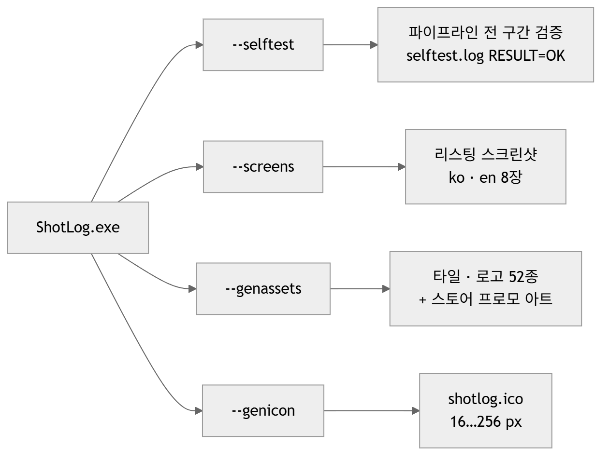
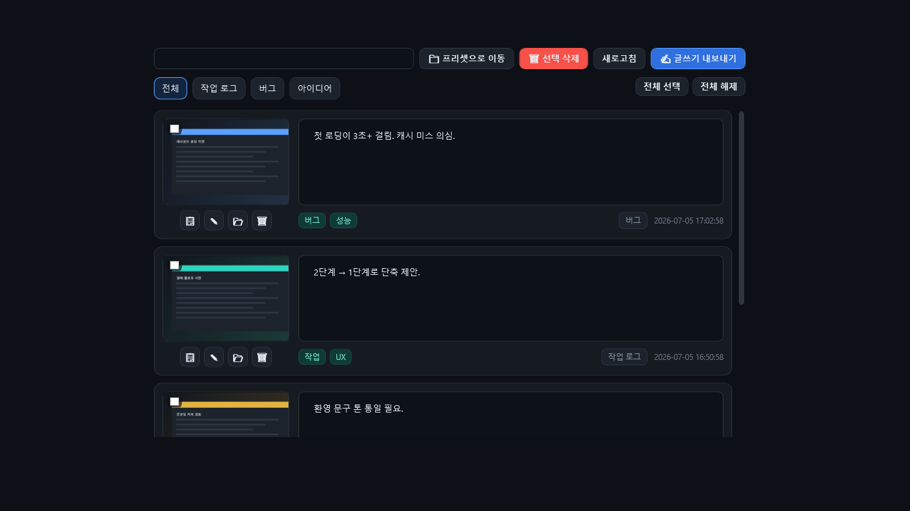

> 테스트 프로젝트가 0개인 앱이 스스로를 검증하고 릴리스 에셋까지 만드는 법 — CLI 훅 네 개.

🗺️ **ShotLog 이야기** · [① 소개]() · [② 업데이트 함정]() · [③ fail-soft 의 뒷면]() · **④ 스스로 찍는 스크린샷**

---

UI 를 한 줄 고쳤습니다. 옵션 하나가 늘어서 창에 행이 하나 추가됐을 뿐입니다.

그런데 그 한 줄 때문에 스토어 리스팅 스크린샷을 여덟 장 다시 찍어야 했습니다. 한국어 넷, 영어 넷. 앱을 띄우고, 언어를 바꾸고, 그럴듯한 샘플 데이터를 손으로 채워 넣고, 창 크기를 맞추고, 캡처하고, 배경을 지우고, 1366×768 캔버스에 앉히고… 여덟 번.

세 번째 릴리스에서 손이 멈췄습니다. 이건 제가 할 일이 아니라는 생각이 들더군요. **화면을 찍는 앱을 만들면서, 정작 그 앱의 스크린샷은 제가 손으로 찍고 있었습니다.**

그래서 앱에게 시켰습니다.

## 창을 열지 않고 회귀를 잡습니다 — `--selftest`

먼저 고백부터. **이 프로젝트엔 테스트 프로젝트가 없습니다.** xUnit 도, NUnit 도, 목 프레임워크도요.

변명이 아니라 판단이었습니다. 이 앱의 핵심 위험은 로직이 아니라 **파이프라인**에 있습니다. 화면을 잡고 → PNG 로 저장하고 → 메모를 사이드카 `.md` 로 쓰고 → 여러 캡처를 묶어 Markdown 문서로 내보내는 흐름. 이게 깨지면 앱이 무너집니다. 그런데 이 흐름은 GDI 와 파일 시스템에 발을 담그고 있어서, 유닛 테스트로 잘라 내면 정작 위험한 부분은 전부 목으로 대체됩니다. **테스트는 통과하는데 앱은 망가지는** 그림이 눈에 선했습니다.

그래서 반대로 갔습니다. 앱 자신에게 그 파이프라인을 **한 번 통째로 걷게** 합니다.

```powershell
dotnet run --project src/ShotLog/ShotLog.csproj -- --selftest
```

`--selftest` 인자를 받으면 앱은 창을 하나도 띄우지 않고, 임시 폴더에서 캡처 → 저장 → 사이드카 → 내보내기 → 단축키 파서까지 실제로 돌린 뒤, **생성된 마크다운 본문까지 통째로** `%APPDATA%\ShotLog\selftest.log` 에 적고 종료합니다. 마지막 줄엔 `RESULT=OK` 나 `RESULT=FAIL` 이 남고요.

두 가지가 중요했습니다. **진짜 저장소를 건드리지 않는다**는 것(전부 `Path.GetTempPath()` 아래), 그리고 **결과물을 눈으로 볼 수 있다**는 것. 통과/실패만 알려 주는 초록 불보다, 실제로 나온 마크다운을 읽는 쪽이 훨씬 많은 걸 잡아냅니다.

## 화면 밖 -10000 에 창을 띄웁니다 — `--screens`

그리고 처음의 그 문제, 스크린샷입니다.

`--screens <폴더> [ko|en]` 을 주면 앱이 이렇게 움직입니다. 언어를 그 언어로 갈아 끼우고, **그럴듯한 가짜 캡처 네 건을 시드**합니다("대시보드 로딩 지연 — 첫 로딩이 3초+ 걸림. 캐시 미스 의심." 같은, 프리셋과 태그까지 붙은 것들). 그리고 인박스·글쓰기·설정·빠른 메모 창을 차례로 띄워 렌더한 뒤, 각각을 1366×768 다크 캔버스 한가운데에 앉혀 저장합니다.

핵심은 창을 **화면 밖 `(-10000, -10000)` 에 띄운다**는 것입니다. 작업 표시줄에도 안 뜨고, 사용자 화면을 가리지도 않고, 그냥 좌표계 저 바깥에서 조용히 그려집니다. 그걸 `RenderTargetBitmap` 으로 굽습니다.



여기서 한 번 데였습니다. `Show()` 하고 바로 렌더하면 **덜 그려진 프레임**이 나옵니다. 레이아웃이 아직 확정되지 않았거든요. 그래서 이렇게 두 번 펌핑합니다.

```csharp
w.Show();
afterShow?.Invoke();
w.UpdateLayout();
w.Dispatcher.Invoke(() => { }, DispatcherPriority.Loaded);   // Loaded 까지 큐를 비운다
w.UpdateLayout();                                            // 그러고 나서 다시 재기
```

가운데 한 줄이 전부입니다. 디스패처 큐를 `Loaded` 우선순위까지 밀어내서 "레이아웃이 다 끝났다"를 보장한 뒤, 한 번 더 확정합니다. 이걸 빼면 아무 오류 없이 **살짝 어긋난 스크린샷**이 나옵니다 — 가장 알아채기 어려운 종류의 실패죠.

지금은 UI 를 고치면 명령 두 줄이면 됩니다. 한국어 넷, 영어 넷, 여덟 장이 다시 나옵니다.



이 글에 붙은 저 스크린샷도 마찬가지입니다. **제가 찍은 게 아니라 앱이 찍은 겁니다.**

## 타일 52종을, 반올림 하나 때문에

스토어에 앱을 올리려면 아이콘이 한 장으로 안 끝납니다. 타일·로고·스플래시가 크기별로 있고, 각각에 **배율 변형**(scale-100 · 125 · 150 · 200 · 400)이 붙습니다. 전부 세면 **52장**입니다.

이걸 손으로 만들 생각은 처음부터 없었습니다. `--genassets` 가 코드로 그려서 내보냅니다. 그런데 처음 MSIX 패키징을 돌렸을 때 **APPX1619** 로 검증이 터졌습니다.

범인은 **정수 나눗셈**이었습니다.

MSIX 는 각 배율 에셋의 크기를 `반올림(원본 × 배율/100)` 으로 **검증**합니다. 그런데 제 코드는 정수 나눗셈으로 계산하고 있었고, 정수 나눗셈은 소수점을 **잘라 버립니다.**

> `71 × 125% = 88.75` → **89** 여야 하는데, 제 코드는 **88** 을 냈습니다.

1 픽셀. 그 1 픽셀 때문에 패키징이 통째로 거부됐습니다. 고친 건 `Math.Round(..., MidpointRounding.AwayFromZero)` 한 줄이고요.

그리고 여기가 이 방식의 진짜 값이 나온 지점입니다. **에셋이 코드니까, 한 줄 고치고 `--genassets` 를 다시 돌리면 52장이 전부 새로 나옵니다.** 이미지 편집기로 만들어 뒀다면 저는 그날 52장을 손으로 다시 뽑고 있었을 겁니다. ([스토어 업데이트가 거부됐던 그날 이야기]()에서 이 에셋들이 잠깐 등장하는데, 그때 제가 태연할 수 있었던 이유가 이겁니다.)

## 테스트가 없는 게 아니라, 다른 데 있었습니다

정리하면 실행 파일 하나가 네 갈래로 갈라집니다. `--selftest` 는 파이프라인을 검증하고, `--screens` 는 리스팅 스크린샷을, `--genassets` 는 타일 52종과 프로모 아트를, `--genicon` 은 아이콘을 만듭니다. 전부 **앱 자신의 코드**로요.

이 방식엔 공짜로 딸려 오는 성질이 하나 있습니다. **에셋과 앱이 절대 어긋나지 않습니다.** 스크린샷은 실제 창을 렌더한 것이고, 타일은 앱 아이콘을 그리는 바로 그 코드가 그린 것이며, 셀프테스트가 뱉는 마크다운은 사용자가 내보내기를 눌렀을 때 나오는 바로 그 마크다운입니다. 릴리스 자료가 낡을 수가 없습니다 — **낡으려면 앱이 먼저 낡아야 하니까요.**

그래서 저는 "이 프로젝트엔 테스트가 없다"는 말을 이제 이렇게 고쳐 씁니다. 테스트가 없는 게 아니라, **테스트가 다른 데 있었습니다.** 별도 프로젝트가 아니라 실행 파일 안에, 플래그 뒤에.

---

돌아보면 이건 도구를 만드는 사람의 아주 기본적인 게으름이었습니다. 같은 일을 세 번 반복하는 순간, "이거 코드가 하면 되잖아"가 떠오르는 그 게으름.

다만 이번엔 조금 더 낯 뜨거운 구석이 있었습니다. **스크린샷 도구가 자기 스크린샷을 못 찍는다면, 그건 좀 부끄러운 일 아닙니까.**

<p align="center">
  <a href="https://apps.microsoft.com/detail/9PC70G3LNQ8Q?hl=ko-kr&gl=KR"><strong>▶ Microsoft Store 에서 ShotLog 설치하기</strong></a>
</p>

---

🗺️ **처음으로** — [① 소개: 캡처와 기록 사이의 틈]()
