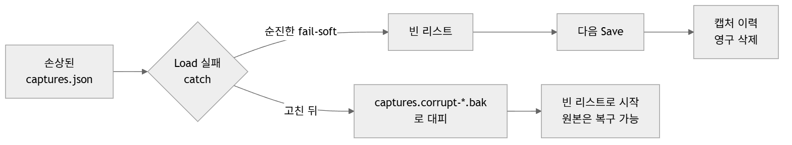

> 예외를 삼키는 코드가 데이터를 지우는 방식 — fail-soft 의 뒷면.

🗺️ **ShotLog 이야기** · [① 소개]() · [② 업데이트 함정]() · **③ fail-soft 의 뒷면** · [④ 스스로 찍는 스크린샷]()

---

안전하려고 세운 규칙이 사실은 가장 위험한 코드였다는 걸 뒤늦게 아는 순간이 있습니다. 저는 그걸 `catch` 블록 하나에서 겪었습니다.

제 앱에는 규칙이 하나 있습니다. **핫키와 저장소 IO 에서는 절대 예외를 던지지 않는다.** 프로젝트 문서 맨 아래 "함정" 항목에 제가 직접 적어 둔 문장이고, 나름 근거도 분명했습니다. 그래서 모든 `Load()` 와 `Save()` 를 `try/catch` 로 감쌌습니다. 앱은 무슨 일이 있어도 죽지 않았고, 저는 그걸 잘한 일이라고 생각했습니다.

그런데 그 규칙을 **순진하게 지킨 코드**가 사용자의 캡처 기록을 통째로, 아무 소리 없이 지울 수 있다는 걸 나중에 알았습니다. 예외를 삼키라는 원칙이, 어느새 **아무것도 알리지 말라**는 뜻으로 변질돼 있었던 겁니다.

## 핫키는 절대 죽으면 안 된다 — 그래서 세운 규칙

먼저 규칙이 왜 필요했는지부터.

제가 만든 ShotLog 는 트레이에 상주하는 캡처 도구입니다([어떤 앱인지는 따로 소개한 글]()에 있습니다). 창이 없으니 사용자는 앱이 살아 있는지 죽었는지 알 방법이 없습니다. 트레이 아이콘이 조용히 사라질 뿐이죠.

그런 앱에서 **단축키 하나 눌렀다고 프로세스가 죽으면** 그건 재앙입니다. 사용자는 `Ctrl+Alt+S` 를 눌렀을 뿐인데, 다음에 누를 땐 아무 일도 일어나지 않습니다. 왜냐고요? 앱이 없어졌으니까요. 그러니 캡처 핸들러는 무슨 일이 있어도 예외를 밖으로 내보내면 안 됩니다.

저장소 IO 도 마찬가지입니다. 설정 파일이 잠겨 있다고, 디스크가 꽉 찼다고 앱이 시작조차 못 하면 곤란합니다. **어떻게든 계속 굴러가는 게 낫다** — 이게 `fail-soft` 입니다.

여기까진 옳았습니다. 문제는 그다음이었습니다.

## 빈 리스트가 진실이 되는 순간

캡처 기록은 `captures.json` 한 파일에 들어 있습니다. 어떤 PNG 에 어떤 메모와 태그가 붙어 있는지를 잇는, 이 앱의 유일한 원장입니다.

`Load()` 는 이렇게 생겼습니다. 파일을 읽고, 파싱하고, 실패하면 삼킵니다. 삼킨 다음엔? **빈 리스트로 시작합니다.** 던지지 않기로 했으니 달리 할 게 없거든요.

그리고 앱은 아주 건강하게 돌아갑니다. 사용자가 캡처를 하나 더 찍습니다. `Save()` 가 호출됩니다. 그 순간 메모리에 있는 **빈 리스트가 파일에 그대로 덮어써집니다.**

원장이 지워졌습니다. 에러도, 경고도, 빨간 글씨도 없이.

여기서 무서운 건 파일이 손상됐다는 사실이 **아닙니다.** JSON 이 반쯤 쓰이다 만 건 흔한 일이고, 그래서 복구도 가능합니다. 무서운 건 **손상이 삭제로 승격되는** 경로입니다. 되돌릴 수 있던 사고를, 제 코드가 되돌릴 수 없는 사고로 바꿔 놓고 있었습니다.

그리고 이건 **첫 실행과 구별되지 않습니다.** 파일이 없어서 빈 리스트인 것과, 파일이 깨져서 빈 리스트인 것 — 코드에서는 똑같이 `new()` 입니다. 앱은 사용자를 처음 보는 사람처럼 맞이합니다. 사실은 그 사람의 지난 몇 달을 방금 지웠으면서요.

## 던지지 말고, 옆으로 치워 둡니다

해법이 "예외를 던지자"가 아니라는 게 이 이야기의 핵심입니다.

던지면 어떻게 될까요. 앱이 시작하다 죽습니다. 사용자는 `captures.json` 이 뭔지도 모르는데 앱이 안 켜집니다. 규칙은 여전히 옳습니다 — **`Load()` 는 절대 throw 하면 안 됩니다.**

고쳐야 할 건 예외 처리가 아니라 **`catch` 안에서 무엇을 하느냐**였습니다. 지금은 이렇게 합니다.

- **먼저 대피시킵니다** — 파싱에 실패한 파일을 `captures.corrupt-20260705-143052.bak` 으로 복사해 둡니다. 시간이 박힌 이름이라 덮어쓸 일도 없습니다.
- **그다음 빈 리스트로 시작합니다** — 앱은 예전처럼 조용히 계속 굴러갑니다.
- **대피도 best-effort 입니다** — 백업을 뜨다 실패해도 삼킵니다. 원칙은 원칙이니까요.

바뀐 건 딱 한 줄짜리 동작입니다. 그런데 사고의 성격이 완전히 달라집니다. 데이터는 **여전히 거기 있고**, 손상된 JSON 은 사람 손으로 열어서 살릴 수 있습니다. 앱이 못 읽는 것과, 세상에서 사라지는 것은 다른 일입니다.

**fail-soft 의 올바른 정의는 "조용히 성공한 척"이 아니라 "조용히 훼손하지 않기"였습니다.**

## 언제 침묵하고, 언제 말을 걸까

같은 시기에 하나 더 고쳤습니다. 이번엔 반대 방향입니다.

캡처가 실패했을 때, 제 코드는 **전부** 침묵하고 있었습니다. 전부 `catch { }` 였거든요. 그런데 곰곰이 보니 캡처 실패는 두 종류였습니다.

- **핫키로 찍는 즉시 캡처·클립보드 캡처** — 사용자는 지금 다른 일에 몰입해 있습니다. 알림은 방해입니다. 여기선 침묵이 맞습니다. 코드 주석에도 그렇게 적었습니다 — *"a hotkey never nags"*.
- **메모·영역·활성 창 캡처** — 사용자가 **의도적으로** 시작한 동작입니다. 창이 뜨기를 기다리고 있습니다. 여기서 조용히 실패하면, 사용자는 자기가 뭘 잘못 눌렀나 한참을 헤맵니다.

그래서 뒤쪽 셋에만 트레이 알림을 붙였습니다. **삼키되, 사용자가 기다리고 있을 때는 말을 겁니다.** 예외를 삼킬지 말지가 아니라, **누가 지금 답을 기다리고 있는가**로 갈랐습니다.

재미있는 건, 이 글을 쓰려고 코드를 다시 읽다가 **똑같은 병을 하나 더 찾았다**는 겁니다. 단축키를 등록하는 코드가 `RegisterHotKey` 의 반환값을 아예 보지 않고 있었습니다. 다른 앱이 이미 그 조합을 쓰고 있으면 Windows 는 예외도 콜백도 없이 그냥 `false` 를 돌려줍니다. 사용자 눈에는? **단축키를 눌렀는데 아무 일도 안 일어납니다.** 앱이 자기를 무시하는 것처럼 보이죠. 지금은 어떤 단축키가 물렸는지 이름을 대며 알려 줍니다.

세 군데 다 같은 실수였습니다. **실패를 처리하는 것과, 실패를 없었던 일로 만드는 것을 헷갈린 것.**

---

돌아보면 `catch { }` 라는 두 글자는 참 유혹적입니다. 저기에 뭘 적을지 고민하는 대신 그냥 비워 두면, 앱은 절대 죽지 않고 로그도 깨끗하고 사용자도 아무 말이 없습니다.

다만 그 조용함이, 잘 돌아가고 있다는 뜻은 아니었습니다. **죽지 않는 것과 괜찮은 것은 다릅니다.**

---

🗺️ **다음 편** — [④ 스스로 찍는 스크린샷: 앱에게 시켰습니다 — 자기 스크린샷을 직접 찍으라고]()
