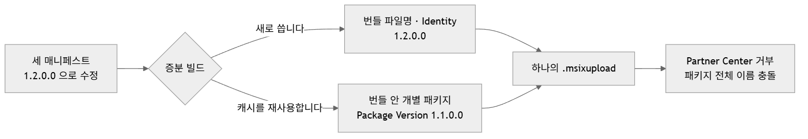

> 첫 게시는 한 번이지만, 업데이트는 계속됩니다 — 두 번째 제출에서 만난 함정들.

🗺️ **ShotLog 이야기** · [① 소개]() · **② 업데이트 함정** · [③ fail-soft 의 뒷면]() · [④ 스스로 찍는 스크린샷]()

---

세 파일의 버전을 전부 `1.2.0.0` 으로 맞췄습니다. `ShotLog.csproj`, `app.manifest`, `Package.appxmanifest`. 이건 제가 제 문서에 손수 적어 둔 규칙이라, 체크리스트를 보면서 한 줄씩 확인까지 했습니다. 빌드하고, 업로드하고, 커피를 한 잔 내리고 돌아왔더니 화면에 빨간 줄이 하나 떠 있더군요.

**"패키지 전체 이름이 이미 존재합니다 — `SlnU.ShotLog_1.1.0.0_X64_…`"**

1.1 이라니. 방금 세 군데를 다 고쳤는데요. 파일 이름조차 `1.2.0.0` 이라고 적혀 있는 그 패키지를, 스토어는 **1.1** 이라고 읽고 있었습니다.

앱을 스토어에 처음 올리던 날의 이야기는 [지난번에 다른 앱으로 한 번 했습니다]() — 미서명 실행 파일 앞에 서던 파란 경고창, 그걸 지우려고 Microsoft 에게 서명을 맡긴 이야기요. 오늘은 그 뒤의 이야기입니다. **첫 게시는 인생에 한 번이지만, 업데이트는 계속 돌아옵니다.** 그리고 업데이트 레인에는, 첫 게시 때는 한 번도 만난 적 없는 함정들이 기다리고 있었습니다.

(ShotLog 가 어떤 앱인지는 [따로 소개한 글]()이 있으니 여기선 접어 두겠습니다. 화면을 찍고 그 자리에 메모를 남기는, 트레이에 사는 작은 도구입니다.)

## 세 곳을 고쳤는데, 네 번째가 있었습니다

문제는 그 버전이 **한 군데 더 있다**는 것이었습니다. 제가 모르던 곳에.

MSIX 번들은 러시아 인형 같은 구조입니다. `.msixupload` 안에 `.msixbundle` 이 들어 있고, 그 번들 안에 개별 패키지가 다시 들어 있습니다. 그리고 **겉껍질에도, 안의 각 패키지에도 버전이 따로 적혀 있습니다.** 제가 고친 버전은 겉껍질까지는 잘 도달했습니다. 파일명도 `1.2.0.0`, 번들 Identity 도 `1.2.0.0`. 그런데 안쪽 개별 패키지의 `<Package Version>` 은 — 옛날 값 그대로였습니다.

범인은 **증분 빌드** 였습니다. MSBuild 는 "안 바뀐 건 다시 안 만든다"는 아주 합리적인 원칙으로 움직입니다. 그런데 그 판단이 패키지 Identity 에까지 미치면, 매니페스트의 버전을 바꿔도 **직전에 구워 둔 개별 패키지를 그대로 재사용**해 버립니다. 겉은 새로 포장하고, 속은 창고에 있던 걸 그대로 담는 셈입니다.

Partner Center 는 겉이 아니라 **속을 봅니다.** 그래서 이미 게시된 1.1.0.0 과 같은 패키지 전체 이름이 올라왔다고 판단하고 거부한 겁니다. 거절 사유는 정확했습니다. 다만 제가 그 문장을 읽을 준비가 안 돼 있었을 뿐이죠.

해법은 허무합니다. **클린 리빌드.** `src\ShotLog\{obj,bin}` 과 `src\ShotLog.Package\{obj,bin,AppPackages}` 를 지우거나, `msbuild … /t:Rebuild` 로 다시 굽습니다. 그게 전부였습니다. 그래서 저는 이 한 줄을 출시 문서 §8 에 ⚠️ 를 달아 박아 뒀습니다 — **"버전 올릴 땐 반드시 클린 리빌드."**

## 패키지를 열어 봐야 압니다

여기서 진짜 교훈은 "클린 리빌드를 하세요"가 아닙니다. 그건 대증요법이고요.

진짜 교훈은 이겁니다. **빌드 산출물이 조용히 거짓말을 할 수 있다면, 나에겐 그걸 열어 볼 방법이 있어야 한다.** 파일명이 `1.2.0.0` 이라는 건 아무 증거도 아니었습니다. 파일명은 그냥 파일명입니다.

그래서 이제는 업로드 전에 패키지를 뜯어봅니다. 어렵지 않습니다 — MSIX 는 그냥 zip 이니까요.

- `.msixupload` 의 압축을 풉니다 → 안에서 `.msixbundle` 이 나옵니다.
- 그 `.msixbundle` 을 다시 풉니다 → `AppxMetadata/AppxBundleManifest.xml` 이 있습니다.
- 그 XML 을 열어 **모든** `<Package Version>` 이 목표 버전인지 확인합니다. 하나라도 옛 값이면 거기서 멈춥니다.

**"모든"** 이라는 말이 핵심입니다. 하나만 보고 넘어갔다면 저는 겉껍질만 확인하고 안심했을 겁니다. 정확히 그래서 처음에 당한 거고요.

익숙한 종류의 버그이긴 합니다 — 캐시가 틀린 답을 자신 있게 내놓는 것. 다만 그게 제 코드가 아니라 **빌드 시스템 안에서** 일어나니, 소스를 아무리 들여다봐도 답이 없었던 겁니다. 문제가 소스에 없을 때는, 산출물을 열어 보는 수밖에요.

## 서명해야 검사할 수 있는데, 서명하면 안 되는 패키지

제출 전에 한 번 돌리는 검사가 있습니다. **WACK**(Windows App Certification Kit) — 스토어 인증에서 볼 항목들을 내 PC 에서 미리 돌려 보는 도구입니다. 그런데 이걸 돌리려는 순간, 앞뒤가 안 맞는 요구 두 개가 정면으로 부딪힙니다.

- **WACK 는** 앱을 **실제로 설치해서** 검사합니다. 그러니 관리자 권한이 필요하고, 무엇보다 **설치 가능한 = 서명되고 신뢰된** 패키지를 요구합니다.
- **스토어 업로드본은** 반드시 **미서명**이어야 합니다. Microsoft 가 대신 서명해 줄 거니까요. 그게 애초에 스토어로 옮긴 이유이기도 하고요.

서명해야 검사할 수 있는데, 서명하면 안 되는 패키지. 매듭을 푸는 길은 하나였습니다 — **검사용과 배포용을 분리하는 것.**

`scripts\run-wack.ps1` 이 그 일을 합니다. 일회용 자체서명 인증서를 만들어 **테스트 번들에만** 서명하고, 신뢰 저장소에 잠깐 넣어 설치를 허용하고, `appcert.exe` 를 돌린 뒤, `finally` 블록에서 **임시 신뢰와 인증서를 전부 걷어냅니다.** 배포용 `.msixupload` 는 처음부터 끝까지 손대지 않습니다. 검사 하나 하자고 제 PC 의 신뢰 저장소에 쓰레기를 남길 순 없으니까요.

여기 함정이 하나 숨어 있습니다. 인증서의 **주체(Subject)가 패키지 `Publisher` 와 글자 하나까지 같아야** 합니다 — ShotLog 라면 `CN=1398342C-A2D7-4B4A-BFE2-34D8CCFD7FBA`. 안 맞으면 설치 단계에서 그냥 거부됩니다.

결과는 **`OVERALL_RESULT = PASS`**. 다만 선택 항목 하나가 FAIL 로 떴는데, 이게 재미있습니다. **"차단된 실행 파일"** — 앱 안에 `cmd`, `reg`, `CreateProcess`, `ShellExecute` 같은 호출이 들어 있다는 겁니다. 저는 그런 코드를 쓴 적이 없습니다.

범인은 **self-contained .NET 런타임** 이었습니다. 런타임을 통째로 안고 배포하다 보니 그 안의 DLL 들이 저 문자열들을 **상수로 품고 있고**, 스캐너가 문자열 검색으로 잡아낸 겁니다. 알려진 오탐이고 OPTIONAL 이라 제출을 막지는 않습니다. 사용자에게 "실행하려면 런타임부터 까세요"라고 하지 않는 대가로, 스캐너에게 한 번 의심받는 셈이죠. 남는 장사라고 봤습니다.

## 내가 배포한 것의 상태를, 내가 모르고 있었습니다

기술적인 함정은 여기까지입니다. 그런데 이날 제가 저지른 가장 큰 실수는, 사실 빌드 시스템과 아무 상관이 없었습니다.

릴리스 노트를 쓰면서 저는 이렇게 생각했습니다. *"1.1.0.0 은 스토어에 안 올렸으니까, 이번 업데이트가 1.0.0.0 이후 첫 업데이트네. 그럼 1.1 때 개선한 것들도 What's new 에 다 넣어야겠다."* 그래서 인박스 개편도, 렌더링 미리보기도, 주석 에디터도 전부 이번 버전의 변경사항인 것처럼 적어 넣었습니다.

**1.1.0.0 은 이미 게시돼 있었습니다.**

기록을 다시 확인하고서야 알았습니다. 사용자가 이미 몇 주 전에 받아서 쓰고 있던 기능들을, "이번에 새로 나왔습니다" 하고 또 소개할 뻔한 겁니다. 급히 되돌렸습니다. What's new 는 실제로 바뀐 것만 안내하고, v1.1.0 항목은 **"이전 버전"** 각주로 내렸습니다. 한국어와 영어, 양쪽 다요.

이게 앞의 세 함정보다 뼈아팠습니다. **버전 캐시는 빌드 시스템이 틀린 거지만, 이건 제가 틀린 겁니다.**

혼자 만들면 개발자이면서 동시에 릴리스 매니저입니다. 코드의 상태는 `git log` 가 알려 주지만, **"내가 세상에 무엇을 내보냈는가"는 아무도 알려 주지 않습니다.** 그건 제 저장소 밖, Partner Center 라는 다른 세계에 있는 사실이니까요. 저는 그걸 제 기억에 맡기고 있었고, 기억은 3주를 못 버텼습니다. 그래서 지금은 출시 문서 맨 위에 **게시 이력**을 적습니다. 어떤 버전이 언제 인증을 통과해 게시됐는지 — 커밋 메시지가 아니라, 다음번의 제가 가장 먼저 열어 볼 자리에.

## 내가 만든 것과, 내가 내보낸 것

돌아보면 이날 배운 세 가지는 한 문장으로 묶입니다. 세 매니페스트를 고쳤다고 패키지가 그 버전인 건 아니고, 파일명이 그렇다고 속까지 그런 건 아니고, 기능을 만들었다고 사용자가 그걸 받은 것도 아닙니다. 그 사이엔 매번 빌드 캐시가, 번들 껍질이, 제 흐릿한 기억이 끼어듭니다. 그러니 확인하는 수밖에요 — 압축을 풀어서, 문서를 열어서, 눈으로.

파란 경고창은 한 번 지우면 끝입니다. 하지만 **내가 뭘 올렸는지 아는 일**은, 매번 새로 해야 하더군요.

  <a href="https://apps.microsoft.com/detail/9PC70G3LNQ8Q?hl=ko-kr&gl=KR"><strong>▶ Microsoft Store 에서 ShotLog 설치하기</strong></a>

---

🗺️ **다음 편** — [③ fail-soft 의 뒷면: 절대 죽지 않게 만들었더니, 조용히 지웠습니다]()
