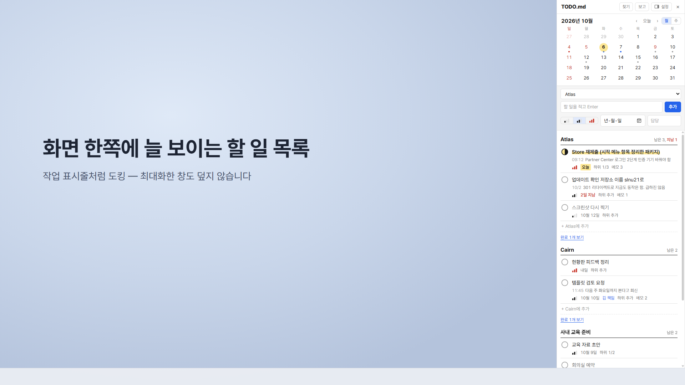
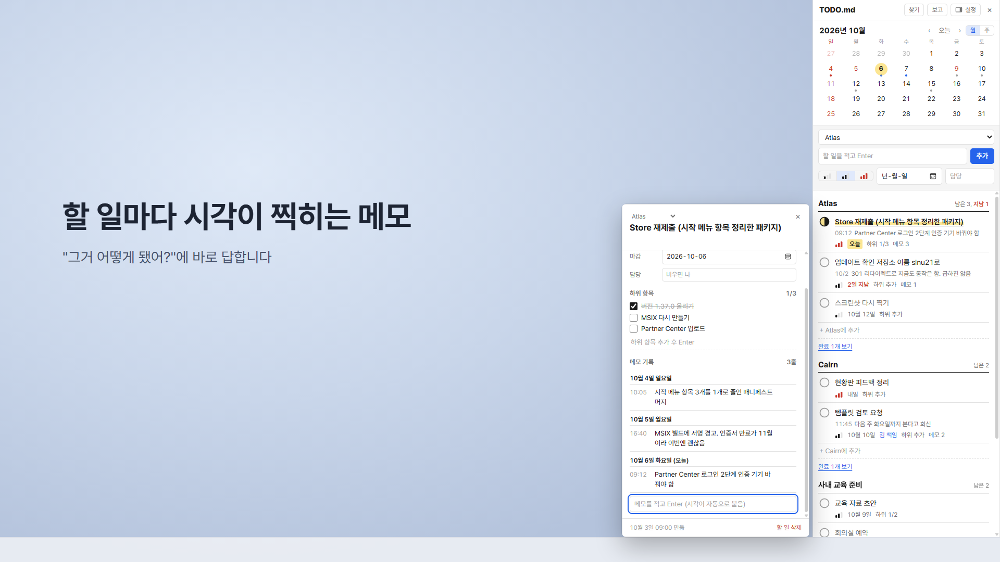
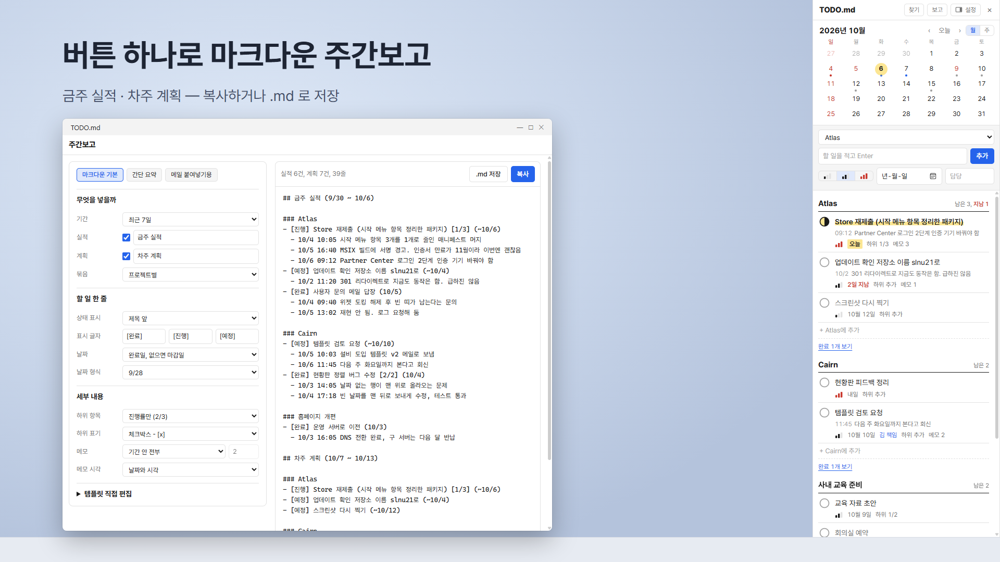

> 까먹지 않으려면, 늘 보여야 했습니다.

바쁜 일은 이상하게 꼭 한꺼번에 옵니다. 메일 하나에 답하는 사이 메신저가 울리고, 그걸 보는 사이 옆자리에서 "이거 잠깐만 봐 줄 수 있어요?" 하고 부르고, 자리로 돌아오면 방금 뭘 하려던 참이었는지가 기억나지 않습니다. 그런 날 필요한 건 거창한 관리 도구가 아니었습니다. **떠오르는 즉시 빠르게 적고, 내가 해야 할 일을 수시로 확인할 수 있는 것** — 그리고 그게 화면 어딘가에 **늘 자리를 차지하고 떠 있는 것.**

마땅한 게 없어서 직접 만들었습니다. **TODO.md** 입니다.

## 스티커 메모부터 원노트까지 — 다 써 봤습니다

처음부터 만들 생각은 아니었습니다. 스티커 메모, 메모장, 원노트… 손에 잡히는 건 다 써 봤습니다. 그런데 공통된 문제가 있었습니다. **다른 창 뒤에 숨는 순간, 저는 그 일을 까먹었습니다.** 메모장에 적어 둔 할 일은 메모장을 다시 열 때까지 존재하지 않는 것과 같았습니다.

그럼 "항상 위"로 띄우면 되지 않을까 싶었는데, 이번엔 반대로 그 창이 다른 창을 덮었습니다. 작업하던 화면 한 귀퉁이가 늘 가려져 있는 것도 은근히 거슬리더군요.

제가 만든 프로젝트 관리 앱 [Atlas]() 도 있었습니다. 하지만 Atlas 는 **프로젝트 전체 업무**를 관리하는 데 맞춰져 있습니다. 오늘 오후에 처리할 자잘한 일 하나하나를 거기에 올리기엔 데이터가 너무 깊어지고, WBS 와 일정이 오히려 짐이 됐습니다. 큰 지도와 오늘의 메모장은 다른 물건이었습니다.

## 작업 표시줄처럼 — 가려지지도, 가리지도 않게

그래서 TODO.md 는 창이 아니라 **작업 표시줄처럼** 화면 한쪽을 차지합니다. 모니터 왼쪽이나 오른쪽에 세로로 도킹되어, 다른 창을 최대화해도 그 자리는 비워 둡니다. 가려지지도 않고, 무엇을 가리지도 않습니다.

입력은 **한 줄**입니다. 프로젝트를 고르고, 적고, Enter. 외울 문법도 없습니다. 정신없는 순간에 필요한 건 정리가 아니라 **일단 붙잡아 두는 속도**니까요. 고른 프로젝트는 그대로 남아 있어서 연달아 몇 개를 적어도 손이 멈추지 않습니다.

## 회의록까지는 아닌 것들 — 시각이 찍히는 메모

일을 하다 보면 동료와 짧게 이야기하다 뭔가가 정해지는 순간이 많습니다. "그건 다음 주 화요일까지 보기로", "인증서는 11월 만료라 이번엔 괜찮음" 같은 것들. 회의록을 쓸 일은 아닌데, 나중에 "그거 어떻게 됐더라?" 하면 꼭 필요해지는 말들입니다.

그래서 할 일마다 **메모 기록**을 붙였습니다. 한 줄 적고 Enter 를 누르면 그 줄에 날짜와 시각이 자동으로 찍힙니다. 할 일 하나에 그동안 오간 결정이 시간순으로 쌓이는 셈입니다.

## 금요일 오후를 덜어 주는 버튼 — 주간보고

회사에는 주간보고가 있습니다. 이번 주에 한 일, 다음 주에 할 일. 매주 쓰는 건데 매주 기억을 더듬어야 하는 게 늘 아까웠습니다. 생각해 보니 그 재료는 이미 TODO.md 안에 다 있었습니다. 끝낸 일, 진행 중인 일, 그리고 그 사이사이 찍어 둔 메모들.

그래서 **버튼 하나로 금주 실적 · 차주 계획**을 마크다운으로 뽑아 주게 했습니다. 복사해서 붙이거나 `.md` 로 저장하면 끝. 회사마다 양식이 다르니 프리셋과 템플릿도 고칠 수 있게 해 두었습니다.

## 보조 모니터 한쪽의 자리

지금 TODO.md 는 제 보조 모니터 한쪽에 늘 붙어 있습니다. 할 일이 생기면 적고, 끝나면 동그라미를 눌러 지웁니다. 기능이 많은 앱은 아니지만, 제가 가장 오래 켜 두는 앱이 됐습니다.

사실 [큐이]() 를 처음 구상할 때 TODO.md 에 붙일까도 생각했습니다. 그런데 들여다볼수록 둘은 반대 방향의 앱이었습니다. **TODO.md 는 알아서 정렬해 주는 내 할 일**이고, **큐이는 내가 손으로 순서를 정하고 에이전트가 맨 뒤에 서는 줄**입니다. 게다가 TODO.md 는 인터넷이 막힌 환경에서도 마음 놓고 쓰는 앱이어야 했는데, 큐이는 에이전트와 이야기하려고 내 PC 안에 작은 통로를 엽니다. 그래서 따로 만들었습니다.

바쁜 일은 여전히 한꺼번에 옵니다. 다만 이제는, 그것들이 화면 한쪽에 줄지어 기다려 줍니다.

  <a href="https://apps.microsoft.com/detail/9NLK1K3WVK8F?hl=ko-kr&gl=KR"><strong>▶ Microsoft Store 에서 TODO.md 설치하기</strong></a>

